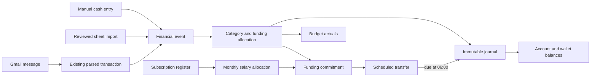
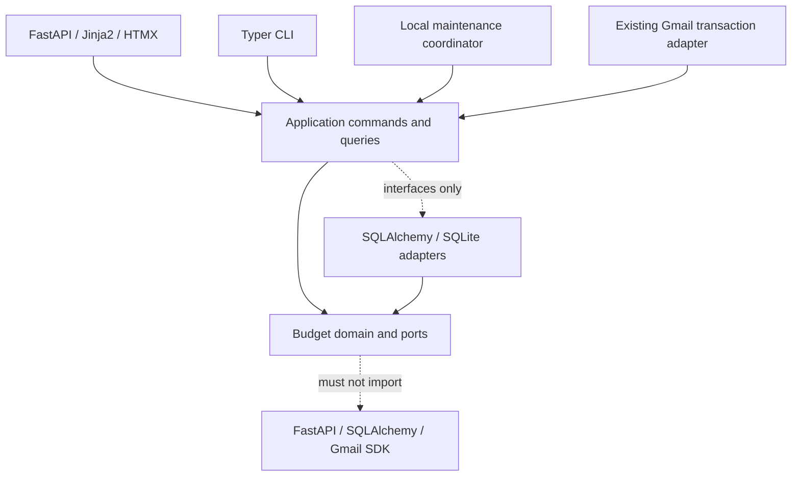
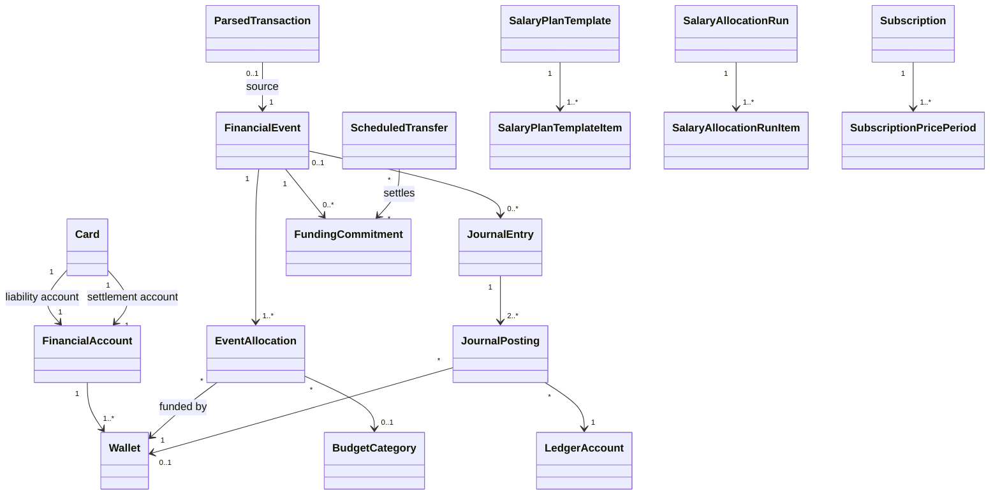
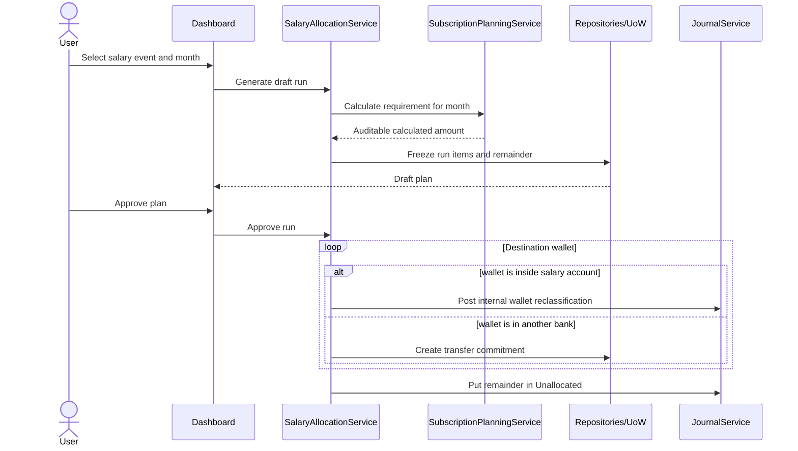
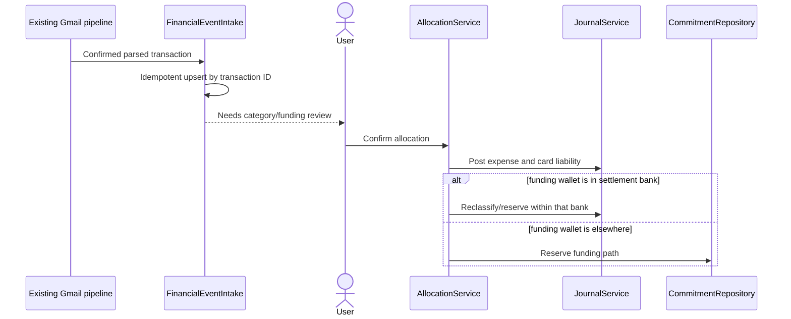
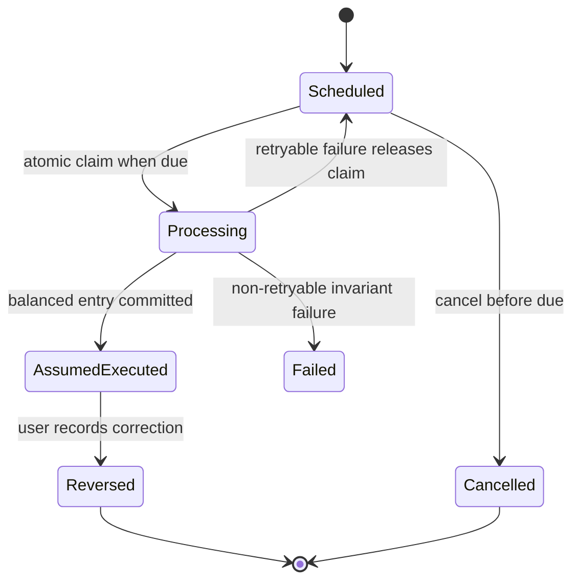
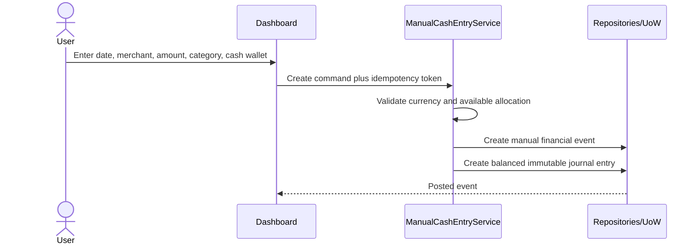
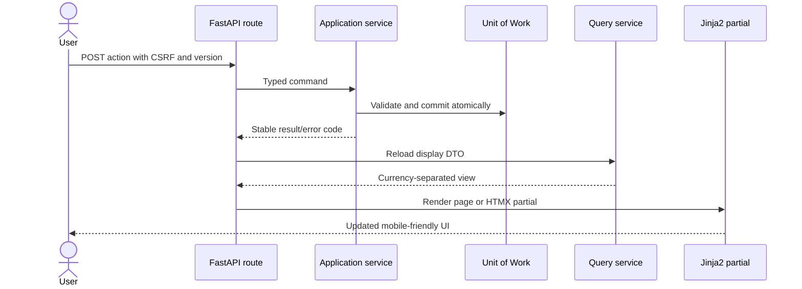

# Scribe Budget and Cash Allocation Architecture

Status: **architecture reviewed on 2026-08-07, amended on 2026-08-08 and
2026-08-09 — Budget Milestones B1 (ledger foundation), B2 (cards and
source-event bridge), B3 (budget periods, allocation, and posting), and B4
(subscription register) accepted; B5 (salary allocation) implemented and
awaiting review; B6 onward not started**

This document plans the next Scribe capability: replacing the current budget
spreadsheets with a local-first account, wallet, subscription, card-settlement,
and cash-flow system. It deliberately contains no migration or production code.
The existing Gmail synchronization, parser, transaction review, and reporting
features remain unchanged until the corresponding implementation milestones are
approved.

## 1. Scope and confirmed operating rules

The following rules are treated as requirements rather than guesses:

- Each real bank account contains multiple virtual wallets. The sum of those
  wallets must equal the account's calculated actual balance.
- Salary enters the Cathay salary account and is allocated by a versioned
  monthly plan. Most allocation funds originate there.
- The monthly spending budget uses calendar months and a normally fixed target,
  but each generated month is frozen so historical plans do not change later.
- Subscription requirements are calculated from one subscription register. The
  result feeds the salary allocation plan instead of being copied manually.
- The Subscription wallet is held at First Bank, even though its funding source
  is the Cathay salary account.
- First Bank's `帳單暫存` wallet is a central clearing hub. No credit card
  directly debits First Bank.
- Sinopac, DBS, and Fubon cards normally settle from an account at their own
  bank. Most other cards normally settle from Taishin. This is configuration,
  not parser logic, and can be changed per card.
- A scheduled clearing transfer is considered executed at 06:00
  `Asia/Taipei` on its scheduled date. This is an explicit user policy, not
  confirmation from a bank.
- Cash expenses can be entered manually.
- Every bank account supports deposits and withdrawals that originate outside
  Scribe's budget/allocation flows. Examples include interest income and a
  direct childcare-insurance debit from Taiwan Business Bank.
- The Scribe Dashboard will gradually become the operating source of truth.
  Google Sheets are migration input and optional one-way export, not a second
  writable source of truth.
- Gmail can group multiple messages in a thread. Source transactions continue
  to be discovered and deduplicated by Gmail **message ID**, after expanding
  relevant threads message by message.

Personal balances, account numbers, card numbers, and the values visible in the
reference spreadsheets must not be committed as fixtures, defaults, or example
configuration.

### Current wallet topology to migrate

The following names are user data to seed through a reviewed import or setup
screen. They document the present ownership correctly, but must remain editable
database configuration rather than Python constants:

- O-Bank: rent.
- First Bank: sports center, commercial insurance, Subscription, health care,
  utilities, travel, `跳跳豆豆`, hypermarket, income tax, and the special
  `帳單暫存` clearing wallet.
- Taiwan Business Bank: childcare labor/health insurance (`育嬰勞健保`),
  daycare, and parents' red-envelope wallet.
- Cathay: investment, living expenses, and supplementary-card wallet.
- Other existing bank accounts and wallets are imported independently even if
  they are not destinations in the monthly salary-allocation template.

In particular, `育嬰勞健保` belongs to Taiwan Business Bank, not First Bank.
The topology records **where money is held**. Budget categories remain separate
so a later move between banks does not rewrite spending history.

## 2. Architectural outcome

The recommended design is an extension of the current modular monolith, not a
separate accounting service. It adds two deliberately separate views of money:

1. **Immutable ledger:** what has actually happened to an account or wallet.
2. **Commitments and schedules:** money reserved or expected to move later.

This distinction is essential for `帳單暫存`. Scheduling a future transfer
reduces the amount still available to schedule, but it must not reduce the
First Bank ledger balance before the 06:00 execution time.



The current `transactions` table remains the parser-owned observation of a
Gmail notification. It is not widened into a general-purpose ledger record,
because it requires an Email foreign key and automatic reparsing legitimately
updates its parsed values. A new `financial_events` boundary makes confirmed
Gmail transactions, manual cash purchases, imports, and future system events
look consistent to the budget domain.

## 3. Module boundaries

The existing dependency direction remains in force: presentation and
infrastructure depend inward on application and domain code.



The dashed `must not import` edge describes a prohibited dependency. Concrete
adapters are selected only in the composition root.

```text
app/
├── domain/
│   ├── budget_models.py          # pure entities/value objects
│   ├── budget_enums.py           # account, event, commitment, schedule states
│   ├── budget_rules.py           # invariants and state transitions
│   └── ports/
│       └── budget_repositories.py
├── application/
│   ├── services/
│   │   ├── financial_event_intake.py
│   │   ├── transaction_allocation.py
│   │   ├── salary_allocation.py
│   │   ├── subscription_planning.py
│   │   ├── scheduled_transfers.py
│   │   ├── manual_cash_entry.py
│   │   └── reconciliation.py
│   ├── queries/
│   │   ├── account_balances.py
│   │   ├── budget_dashboard.py
│   │   └── transfer_schedule.py
│   └── dto/
│       └── budget.py
├── infrastructure/
│   └── database/
│       ├── budget_models.py
│       ├── budget_repositories.py
│       ├── budget_queries.py
│       └── migrations/
├── presentation/
│   ├── cli/
│   │   └── budget.py
│   └── web/
│       ├── routes/budget.py
│       ├── templates/budget/
│       └── static/
└── worker/
    └── local_maintenance.py      # due-transfer processing and catch-up
```

The exact file split should follow implementation pressure. The important
boundaries are:

- Domain rules never import SQLAlchemy, FastAPI, Typer, Gmail, or time-zone
  system APIs.
- Application services own use-case orchestration and transaction boundaries.
- Repository implementations own SQLAlchemy access.
- Query services may use optimized read SQL but routes do not.
- Existing Gmail parsers do not decide wallets, categories, settlement accounts,
  or journal postings.
- The 06:00 policy uses an injected clock and time-zone service.

### Core relationship diagram



## 4. Terminology and domain model

### Financial account

A real-world balance container, such as a checking account, cash on hand, or a
credit-card liability. It has institution, display name, currency, active
status, and optional masked reference. Full account or card numbers are never
required.

### Wallet

A local envelope within one asset account, such as living expenses,
subscriptions, rent, or `帳單暫存`. Every asset account has exactly one
`Unallocated` wallet. Wallets are not separate bank accounts.

### Card

A locally configured card identified by issuer plus last four digits, with an
explicit settlement account. Supplementary-card ownership remains metadata on
the card. Card issuer, funding source, clearing hub, and settlement account are
independent concepts.

### Financial event

A canonical economic event. Its origin can be:

- `gmail_transaction`
- `manual`
- `import`
- `system`

A Gmail-origin event links to one existing parsed transaction. Manual cash
entries have no fake Email and no parser provenance.

### Allocation

The assignment of an event to a budget category and funding wallet. One event
may be split across multiple categories or wallets, while the common case has
one allocation.

### Commitment

A reserved amount that must be funded or transferred later. It affects
availability but is not an actual ledger movement. A card purchase funded from
another bank creates a commitment from the chosen funding wallet to the
clearing/settlement path.

### Journal entry and posting

An immutable balanced record of actual movement. Corrections create a reversal
and replacement entry; posted records are never silently edited or deleted.

### Scheduled transfer

A user-created instruction describing when an amount should leave one account
or wallet and arrive at another. It may settle one or more commitments.

### Balance snapshot

An optional user-entered bank-app balance used for reconciliation. It does not
overwrite the ledger; the system shows the difference.

## 5. Non-negotiable invariants

1. Money is an integer minor-unit amount plus currency; no `float`.
2. A journal entry balances independently for each currency.
3. Posted journal entries are immutable. Corrections use reversal entries.
4. The sum of wallet balances for an asset account equals that account's
   calculated ledger balance.
   Every posting to a wallet-managed physical asset account therefore includes
   a wallet; omitted destination wallets resolve explicitly to that account's
   `Unallocated` wallet.
5. An asset account always has an `Unallocated` wallet, which absorbs imported
   opening balances and unassigned differences.
6. A schedule or commitment cannot pretend a bank movement already occurred.
7. Available wallet balance is calculated as:

   ```text
   ledger wallet balance
   - open commitments
   - reservations not already represented by those commitments
   ```

8. A Gmail transaction becomes eligible for posting only after it is confirmed
   and its allocation is complete. `likely` or `uncertain` data remains a
   suggestion.
9. Import, retry, parser rerun, worker catch-up, and web form resubmission are
   idempotent.
10. Currency conversion is out of scope initially. Different currencies are
    never added together.
11. Historical salary runs and budget periods retain the values generated at
    that time, even after a template or subscription price changes.
12. The assumed 06:00 execution is clearly labeled as policy-derived, not
    bank-confirmed.
13. A real bank movement is recorded in the journal even when it has no salary
    allocation, card, clearing commitment, or monthly budget relationship.
14. An external deposit or debit must identify the affected bank account and
    wallet. If the wallet is not yet known, it is posted to `Unallocated` and
    remains visible for later reclassification.

## 6. Data model and database schema

All tables use integer primary keys, UTC `created_at`/`updated_at` timestamps,
foreign keys, and explicit indexes. User-facing effective times are stored as
aware UTC instants with the originating local date/time-zone retained when it
matters. SQLite foreign keys and WAL stay enabled under the existing policy.

### 6.1 Accounts and wallets

`financial_accounts`

- `id`
- `institution_code`
- `display_name`
- `account_type`: `checking`, `savings`, `cash`, `card_liability`, `other`
- `currency`
- `masked_reference` nullable
- `is_active`
- timestamps
- unique active display identity within institution/currency

`wallets`

- `id`
- `financial_account_id`
- `name`
- `purpose`: `general`, `budget`, `clearing_hub`, `unallocated`
- `is_active`
- timestamps
- unique `(financial_account_id, name)`
- partial/application invariant: one `unallocated` wallet per asset account

`balance_snapshots`

- `id`
- `financial_account_id`
- `balance_minor`
- `observed_at`
- `source`: initially `manual`
- `note`
- timestamps
- index `(financial_account_id, observed_at)`

### 6.2 Cards

The existing supplementary-card setting should migrate into a richer `cards`
record rather than be duplicated.

`cards`

- `id`
- `gmail_account_id`
- `issuer_code`
- `display_name`
- `last_four`
- `holder_role`: `primary`, `supplementary`, `unknown`
- `configuration_status`: `incomplete`, `ready`
- `liability_account_id` nullable while incomplete
- `settlement_account_id` nullable while incomplete
- `default_funding_wallet_id` nullable
- `active_from`, `active_to` nullable
- timestamps
- unique active `(gmail_account_id, issuer_code, last_four)`

The mapping is explicitly editable because the current rule (some issuers use
their own account; most others use Taishin) may change without changing parsers.

### 6.3 Canonical events and allocations

`financial_events`

- `id`
- `origin`: `gmail_transaction`, `manual`, `import`, `system`
- `source_import_key` nullable
- `event_type`: purchase/refund/transfer/withdrawal/deposit/bill payment/
  subscription/fee/interest income/direct debit/adjustment
- `payment_method`: `cash`, `credit_card`, `bank_account`, `transfer`, `other`
- `recognition_basis`: `observed_manual`, `gmail_notification`, `imported`,
  `scheduled_assumption`
- `occurred_at`
- `merchant`
- `amount_minor`
- `currency`
- `card_id` nullable
- `status`: `draft`, `needs_allocation`, `ready`, `posted`, `ignored`, `reversed`
- `note`
- `version` for optimistic concurrency
- timestamps
- unique origin-specific idempotency key

`financial_event_source_links`

- `id`
- `financial_event_id`
- `transaction_id`
- `status`: `candidate`, `confirmed`, `rejected`
- `match_score_bps`: integer 0–10000
- `reason_json`: bounded, non-sensitive matching reasons
- `reviewed_at` nullable
- timestamps
- unique `(financial_event_id, transaction_id)`
- at most one confirmed financial event per parsed transaction

This link table permits a manually entered credit-card purchase to be connected
to a Gmail transaction that arrives later. Candidate links never create another
journal entry.

`budget_categories`

- `id`
- `name`
- `parent_id` nullable
- `is_active`
- timestamps

`event_allocations`

- `id`
- `financial_event_id`
- `budget_category_id` nullable
- `funding_wallet_id`
- `amount_minor`
- `currency`
- `allocation_source`: `rule`, `manual`, `import`
- timestamps
- sum per event must equal the event amount before posting

Budget category answers “what was this for?”; wallet answers “which reserved
money pays for it?” They must not be conflated.

### 6.4 Immutable ledger

`ledger_accounts`

- `id`
- `code`
- `name`
- `kind`: asset, liability, expense, income, equity, clearing
- `currency`
- optional `financial_account_id`
- timestamps

`journal_entries`

- `id`
- `financial_event_id` nullable
- `entry_type`
- `effective_at`
- `recorded_at`
- `idempotency_key` unique
- `reversal_of_id` nullable
- `description`
- timestamps

`journal_postings`

- `id`
- `journal_entry_id`
- `ledger_account_id`
- `wallet_id` nullable
- `amount_minor` signed integer
- `currency`
- `budget_category_id` nullable
- timestamps
- index `(ledger_account_id, wallet_id)`

The service validates that postings total zero per currency before the Unit of
Work commits. Database constraints cover referential and idempotency safety;
cross-row balancing is an application invariant with tests.

### 6.5 Commitments and clearing schedules

`funding_commitments`

- `id`
- `financial_event_id`
- `source_wallet_id`
- `clearing_wallet_id` nullable
- `settlement_account_id`
- `amount_minor`
- `currency`
- `status`: `open`, `partially_scheduled`, `scheduled`, `funded`, `cancelled`
- timestamps
- unique event/allocation identity

`scheduled_transfers`

- `id`
- `source_account_id`
- `source_wallet_id`
- `destination_account_id`
- `destination_wallet_id` nullable
- `amount_minor`
- `currency`
- `scheduled_local_date`
- `scheduled_time` default `06:00:00`
- `timezone` default `Asia/Taipei`
- `due_at_utc`
- `status`: `scheduled`, `processing`, `assumed_executed`, `cancelled`,
  `reversed`, `failed`
- `execution_policy`: initially `assume_at_due_time`
- `executed_entry_id` nullable
- `processed_at` nullable
- `last_error_code`, `last_error_message` nullable
- `version`
- timestamps
- index `(status, due_at_utc)`

`scheduled_transfer_commitments`

- `scheduled_transfer_id`
- `funding_commitment_id`
- `amount_minor`
- composite primary key

This join permits one bank transfer to cover several purchases while preserving
traceability back to every transaction.

### 6.6 Salary plan and monthly budget

`salary_plan_templates`

- `id`, `name`, `currency`, `is_active`, timestamps

`salary_plan_template_items`

- `id`
- `template_id`
- `destination_wallet_id`
- `budget_category_id` nullable
- `calculation_mode`: `fixed`, `subscription_requirement`, `manual`
- `fixed_amount_minor` nullable
- `display_order`
- effective date range
- timestamps

`salary_allocation_runs`

- `id`
- `template_id`
- `budget_period_id`
- `salary_event_id`
- `salary_amount_minor`
- `planned_amount_minor`
- `remainder_minor`
- `status`: `draft`, `approved`, `partially_funded`, `funded`, `cancelled`
- timestamps
- unique `(template_id, budget_period_id)`

`salary_allocation_run_items`

- `id`
- `run_id`
- source template item reference nullable
- destination wallet/category
- frozen calculation mode and amount
- `funding_commitment_id` nullable
- timestamps

`budget_periods`

- `id`
- `year`, `month`, `currency`
- `status`: open, closed
- timestamps
- unique `(year, month, currency)`

`budget_targets`

- `id`
- `budget_period_id`
- `budget_category_id`
- `target_minor`
- source template/version metadata
- timestamps
- unique period/category
- `month_end_destination_wallet_id` nullable; when set, closing the period
  creates an internal transfer of the unused amount to that wallet

Generating a month copies template values into immutable run/target rows.
Changing the fixed monthly template affects only future months unless the user
explicitly regenerates an unapproved draft.

### 6.7 Subscription register

`subscriptions`

- `id`
- `name`
- `budget_category_id`
- `funding_wallet_id`
- `currency`
- `billing_cadence`: monthly, yearly, custom
- `cadence_months`
- `billing_month`/`billing_day` nullable
- `active_from`, `active_to` nullable
- `is_active`
- timestamps

`subscription_price_periods`

- `id`
- `subscription_id`
- `amount_minor`
- `effective_from`, `effective_to` nullable
- timestamps
- non-overlapping date ranges per subscription

The monthly Subscription requirement is computed from the register. Annual or
custom charges use deterministic minor-unit allocation so rounding remainders
are assigned to defined months and the period total remains exact. The generated
salary run freezes the computed requirement for auditability.

## 7. Core workflows

### 7.1 Salary receipt and allocation



An internal Cathay wallet allocation changes wallet composition but not Cathay's
total. Cross-bank allocation becomes a commitment until the real transfer is
recorded. This prevents the Dashboard from claiming another bank already holds
funds merely because a plan was approved.

For cross-bank salary allocations, approval only reserves and presents the
transfer. The user must press **已轉帳** after completing it in the bank app.
That action posts the real account-to-account movement using the user-confirmed
effective time. It is intentionally different from the First Bank clearing
hub's automatic 06:00 policy.

### 7.2 Gmail card purchase



The purchase creates the expense once. A later bank transfer and later card
autopay move assets or clear a liability; neither creates a second expense.

### 7.3 First Bank clearing hub and 06:00 execution

Before execution, a scheduled transfer reserves the relevant open commitments
but leaves actual account and wallet ledger balances unchanged.



At or after 06:00 on the scheduled date:

1. The maintenance worker atomically claims the row.
2. It creates one balanced journal entry with a unique execution key.
3. First Bank `帳單暫存` decreases and the configured destination
   settlement wallet/account increases.
4. Linked commitments become funded to the covered amount.
5. Status becomes `assumed_executed`; `effective_at` remains the scheduled
   06:00 instant, while `processed_at` records when the Mac actually caught up.

The UI must say **已自動視為轉出**. It must not say bank-confirmed or imply a
bank API was queried. If the schedule was wrong, the user creates a reversal and
replacement instead of modifying the posted row.

### 7.4 Card autopay

Card settlement is modeled independently from funding:

- A card explicitly names its actual debit account.
- The clearing hub may fund that account earlier.
- Autopay posts a transfer from settlement-bank asset to card liability.
- The initial design records autopay from a scheduled amount and due date. At
  the configured time (default 06:00 Asia/Taipei), the maintenance coordinator
  marks it `assumed_executed` and posts settlement-bank asset against card
  liability.
- The UI shows that this is schedule-assumed, not bank-confirmed. A later bank
  notification or balance reconciliation detects discrepancies without posting
  a duplicate payment.

### 7.5 Manual cash expense



There is no synthetic Email, Gmail label operation, parser run, or fake
confidence score.

### 7.6 External bank deposit or debit

External movements are first-class events, not unexplained balance edits:

```mermaid
sequenceDiagram
    actor User
    participant Source as Manual / Gmail / Import / Schedule
    participant Service as BankMovementService
    participant Ledger as JournalService
    participant Reconcile as ReconciliationQuery

    User->>Source: Record or review bank movement
    Source->>Service: Account, wallet, direction, amount, category
    alt interest or other deposit
        Service->>Ledger: Debit bank asset; credit income/counterparty
    else direct debit or bank fee
        Service->>Ledger: Debit expense/counterparty; credit bank asset
    end
    Ledger-->>Reconcile: Updated account and wallet balance
```

Examples under the confirmed topology:

- Interest paid into an account increases that account and either a selected
  wallet or `Unallocated`; it may be categorized as interest income.
- A childcare labor/health-insurance debit directly from Taiwan Business Bank
  reduces that bank's corresponding wallet and records the expense. It does not
  pass through a card liability, Taishin, or First Bank `帳單暫存`.
- Fees, refunds, cash deposits, transfers from an untracked counterparty, and
  other account adjustments follow the same path.

Predictable movements may have an optional recurring rule, but a rule must state
whether it only creates a reminder or is allowed to create a
`scheduled_assumption`. Uncertain interest amounts default to observed/manual or
notification-based recording; the system does not invent an amount.

## 8. Repository interfaces

These are indicative responsibilities, not code to implement prematurely:

```python
class FinancialAccountRepository(Protocol):
    def get(self, account_id: int) -> FinancialAccount | None: ...
    def list_active(self) -> tuple[FinancialAccount, ...]: ...
    def add(self, account: FinancialAccountDraft) -> FinancialAccount: ...


class WalletRepository(Protocol):
    def get(self, wallet_id: int) -> Wallet | None: ...
    def list_for_account(self, account_id: int) -> tuple[Wallet, ...]: ...


class FinancialEventRepository(Protocol):
    def get(self, event_id: int) -> FinancialEvent | None: ...
    def get_by_source_transaction(
        self, transaction_id: int
    ) -> FinancialEvent | None: ...
    def add(self, draft: FinancialEventDraft) -> FinancialEvent: ...


class JournalRepository(Protocol):
    def get_by_idempotency_key(self, key: str) -> JournalEntry | None: ...
    def add_balanced(self, draft: JournalEntryDraft) -> JournalEntry: ...


class CommitmentRepository(Protocol):
    def list_open_for_wallet(self, wallet_id: int) -> tuple[FundingCommitment, ...]: ...
    def reserve_for_schedule(self, command: ScheduleFundingCommand) -> None: ...


class ScheduledTransferRepository(Protocol):
    def claim_due(
        self, now: datetime, owner: str, limit: int
    ) -> tuple[ScheduledTransfer, ...]: ...
    def mark_assumed_executed(
        self, transfer_id: int, entry_id: int, processed_at: datetime
    ) -> None: ...
```

All write repositories participate in the existing explicit Unit of Work.
Aggregate reads and reports belong in query repositories/services and can return
DTOs optimized for the page.

## 9. Source integration rules

### Gmail

- Preserve the existing `Email 1 — N parsed transaction` relationship.
- Expand matching Gmail threads and inspect each contained message.
- Deduplicate and checkpoint by Gmail message ID, never thread ID alone.
- Only confirmed, non-ignored effective transaction values can be promoted into
  financial events.
- Before creating a new Gmail-origin financial event, source intake searches
  unlinked manual credit-card events with the same currency, exact amount,
  compatible card, bounded time window, and merchant evidence. One unique exact
  match may be linked deterministically; ambiguous candidates require review
  and do not post a duplicate event.
- A parser rerun may refresh the source observation but never silently rewrite
  an already posted journal entry. If the source changes materially, create a
  review discrepancy.
- Applying a Gmail processed label remains an optional, separately authorized
  operation and does not prove ledger posting.

### Manual and imported data

- Manual entries use a client idempotency token.
- Sheet import first produces a preview with errors and duplicate candidates.
- Imported rows retain batch ID and source row key for traceability.
- No two-way live Google Sheet synchronization is planned.

## 10. Dashboard architecture

The first budget UI should be server-rendered Jinja2 plus HTMX, matching the
current application and mobile design.

Recommended pages:

- `/money` — actual balances, available balances, open commitments, and
  reconciliation warnings by bank/account.
- `/money/accounts/{id}` — wallet composition, ledger activity, snapshot
  difference, `Unallocated` amount, and explicit **新增入帳／新增扣款** actions.
- `/money/daily` — date-first browsing with `all`, `cash`, and `credit_card`
  filters plus one **新增花費** action that branches by payment method.
- `/budget/{yyyy-mm}` — target, actual, committed, available, and unallocated
  amounts per category without cross-currency addition.
- `/allocations/{yyyy-mm}` — generated salary plan, frozen inputs, approval,
  funding status, and remainder.
- `/subscriptions` — editable service register and future monthly requirement.
- `/clearing` — First Bank hub commitments and scheduled/assumed-executed
  transfers.
- `/cards` — issuer, last four, primary/supplementary status, settlement bank,
  and default funding wallet.
- `/money/expenses/new` — mobile-first cash or credit-card expense form.
- `/money/reconcile` — enter bank-app snapshots and investigate differences.

The page vocabulary must distinguish:

- `實際帳面餘額` — ledger amount
- `已保留` — open commitments/schedules
- `可用` — balance after reservations
- `已自動視為轉出` — 06:00 policy execution
- `已由銀行確認` — reserved for a future real bank-data integration

Money-changing POST routes retain CSRF protection, optimistic concurrency, and
allowed-origin checks. Budget routes contain more sensitive balances than the
existing transaction report and should initially be localhost-only. Publishing
them through the Cloudflare Tunnel requires a separate Access policy decision;
the existing public report route must not automatically gain access.



## 11. Local maintenance worker

The current `LocalSyncWorker` is an in-process worker dedicated to Gmail sync.
It should not become a general scheduler. Add a small
`LocalMaintenanceCoordinator` with one responsibility: claim and execute due
database jobs.

Initial operating model:

- Run catch-up during application startup.
- Poll a short interval while `serve` is running.
- Use an atomic SQLite lease/claim so only one process executes a transfer.
- Use unique journal idempotency keys, making a crash after commit safe.
- Record structured errors without account numbers or notes.
- Offer a CLI command for diagnostics and manual catch-up.

Considered options:

| Option | Benefit | Limitation | Decision |
| --- | --- | --- | --- |
| FastAPI background task only | Minimal setup | Lost on restart and weak scheduling semantics | Reject |
| Extend Gmail `LocalSyncWorker` | Reuses a running thread | Mixes unrelated leases, errors, and lifecycle | Reject |
| Separate in-process maintenance coordinator | Local-only, testable, no extra dependency | Runs only while Scribe is awake | Recommend initially |
| Separate launchd worker process | Survives web restarts and has stronger isolation | More installation/coordination complexity | Hardening option |
| Celery/Redis/cloud queue | Mature distributed jobs | Violates local simplicity and is unnecessary | Out of scope |

Limitation: if the Mac is asleep at 06:00, execution is processed on the next
wake/start. The accounting `effective_at` is still 06:00 and `processed_at`
shows the delay. This is correct for the user's declared policy and does not
claim real-time bank execution.

## 12. Reconciliation and corrections

Because Scribe has no bank-balance API, equality with actual bank balances is a
reconciliation goal, not something the system can independently guarantee.

1. User records the balance visible in a bank app.
2. Query service calculates Scribe's ledger balance at the same instant.
3. Dashboard shows the signed difference.
4. User locates a missing transfer/fee/cash movement or records an explicit
   adjustment with a reason.
5. The snapshot remains historical evidence; it never rewrites postings.

Opening balances enter through an auditable opening journal entry, assigned to
existing wallets plus `Unallocated`. Posted mistakes use reversal entries.
External bank movements are therefore normal ledger activity; `adjustment` is
reserved for a genuine reconciliation correction and cannot replace a known
interest, fee, transfer, or direct debit.

## 13. Google Sheet migration and cutover

Recommended process:

1. Export the relevant Sheets to local CSV/XLSX.
2. Import only configuration first: accounts, wallet names, card mapping,
   subscription register, and salary template.
3. Show a preview with normalized names, amounts, destination accounts, and
   validation errors.
4. Have the user approve the preview.
5. Enter one reconciled opening balance and wallet split per account at a chosen
   cutover date.
6. Start operational entries in Scribe from that date.
7. Keep Sheets read-only as an archive; optionally provide one-way export.

Reconstructing years of ledger history from formula-driven sheets is not the
default. It is expensive to verify and unnecessary for a clean future source of
truth.

## 14. Error strategy

Add recognizable domain/application errors:

- `UnbalancedJournalError`
- `CurrencyMismatchError`
- `InsufficientAvailableFundsError`
- `IncompleteAllocationError`
- `DuplicateFinancialEventError`
- `InvalidScheduleTransitionError`
- `ScheduledTransferAlreadyClaimedError`
- `ReconciliationError`
- `ImportValidationError`
- `ConcurrentBudgetEditError`

Every error has a stable code, retryability classification, safe user message,
and internal exception chain. Worker failures persist sanitized details and do
not block Gmail sync or offline Dashboard access. A single bad import row does
not partially post an approved batch.

## 15. Privacy and security

- Store only institution, user-selected account name, and optional masked
  reference; no online-banking password or full account/card number.
- Never automate or screen-scrape bank applications in this design.
- Keep all budget and ledger data in the existing local SQLite database. The
  database is not encrypted at rest; FileVault and protected backups are
  strongly recommended.
- Exclude local exports, balance screenshots, credentials, tokens, and SQLite
  files from Git.
- Do not log balances, transfer notes, full merchant evidence, bodies, secrets,
  or identifying numbers.
- Preserve localhost binding. If remote budget access is approved later, require
  Cloudflare Access, HTTPS, short scoped sessions, CSRF checks, and an explicit
  route allowlist.
- Google Sheet import is local file processing. No financial data is sent to an
  LLM or other external service.
- Backup/restore must cover database consistency; restoring the database must
  not cause due schedules to double-post because execution keys are durable.

## 16. Testing strategy

### Unit tests

- integer minor-unit arithmetic and currency mismatch rejection
- wallet/account sum invariant
- balanced journal construction and reversal
- availability with commitments and schedules
- subscription monthly/yearly/custom calculations and rounding
- salary template generation and historical freezing
- per-card settlement mapping
- schedule state machine and Asia/Taipei 06:00 conversion, including DST-safe
  generic time-zone behavior
- manual cash entry validation
- external interest/deposit and direct-debit posting rules
- period close sweeps unused budget to its configured destination wallet

### Repository and migration tests

- foreign keys, uniqueness, indexes, and optimistic versions
- idempotent source event and journal keys
- atomic due-row claims across two database sessions
- rollback leaves no partial journal or partially approved import
- migration from the current schema preserves every Email and transaction

### Integration tests

- confirmed Gmail transaction to allocation, expense, liability, and commitment
- parser rerun after posting produces review discrepancy, not mutation
- cross-bank salary allocation remains commitment until a transfer posts
- same-account wallet allocation preserves account total
- First hub schedule before/after 06:00
- asleep-at-due-time catch-up with original effective time
- schedule grouping over multiple commitments
- reversal and replacement
- opening balance plus reconciliation snapshot
- direct Taiwan Business Bank debit changes that account and wallet only
- scheduled card autopay clears liability exactly once
- anonymized Sheet preview/import

### Web and security tests

- mobile layouts, CSRF, origin allowlist, and optimistic conflict paths
- external routes cannot reach budget pages by default
- amount displays respect currency exponent
- no totals combine currencies
- HTML escaping and safe validation messages

Existing Ruff, mypy, pytest, and coverage gates remain mandatory for each
implementation milestone.

## 17. Implementation roadmap

Only one milestone should be implemented and committed at a time.

### Budget Milestone B0 — Architecture (this document)

- Confirm invariants, workflows, schema direction, and ADRs.
- No functional code or migration.

### B1 — Ledger foundation (accepted)

- Financial accounts, wallets, ledger accounts, immutable journal, opening
  balances, repositories, migrations, and unit/repository tests.
- CLI setup only; no salary or Gmail bridge yet.
- Delivered as Alembic revision `0005_ledger_foundation` plus the
  `python -m app money` sub-application. Journal postings are signed
  debit-positive integers and are validated to balance per currency before the
  Unit of Work commits.

### B2 — Cards and source-event bridge (accepted)

- Rich card/settlement configuration.
- Promote confirmed existing transactions into reviewable financial events.
- Persist source-link candidates so later manual/Gmail reconciliation cannot
  double-post an expense.
- Preserve message-level Gmail provenance and parser/manual protections.
- Delivered as Alembic revision `0006_cards_and_financial_events` plus the
  local-only `/cards` and `/money/review` pages and the
  `python -m app money intake-confirmed` / `cards-backfill` commands. Intake
  writes no journal entry; posting remains B3.

### B3 — Budget periods and allocations

- Categories, fixed calendar-month targets, split allocations, commitments, and
  budget query service.
- Mobile review/allocation workflow.

### B4 — Subscription register

- Effective-dated subscription prices and cadence calculations.
- Subscription requirement preview and tests.
- Delivered as Alembic revisions `0008_subscriptions`,
  `0009_subscription_intervals`, and `0010_subscription_interval_invariants`,
  plus the local-only `/subscriptions` page and
  the `python -m app money subscription-*` commands. The calculation is
  read-only: it posts nothing and reserves nothing.

### B5 — Salary allocation

- Versioned templates, frozen monthly runs, remainder handling, same-bank wallet
  reclassification, and cross-bank commitments.
- Delivered as Alembic revisions `0011_salary_allocations` and
  `0012_salary_regeneration_provenance`, plus the local-only `/allocations`
  and `/allocations/templates` pages and the `python -m app money salary-*`
  commands. A cross-account line reserves
  through its own `waiting_transfer` status (ADR-B043); the real movement is
  posted only when the user confirms it (ADR-B047).

### B6 — Clearing hub and scheduled transfers

- First Bank hub view, commitment grouping, 06:00 scheduler, startup catch-up,
  atomic claims, reversal, and worker diagnostics.

### B7 — Manual cash and reconciliation

- Daily date-first activity, manual cash and credit-card expense entry, external
  bank movements, Gmail/manual source matching, bank balance snapshots,
  discrepancy workflow, and opening balance/correction UX.

### B8 — Consolidated Dashboard

- Consolidated mobile-first money/budget pages.
- Navigation and cross-feature workflows matching the approved Prototype.

### B9 — Sheet cutover and hardening

- Local preview import, approved cutover, and one-way export.
- Privacy, performance, backup/restore, and large-data hardening.

## 18. Major trade-offs

### Double-entry journal vs direct balance columns

The journal adds tables and domain rules, but scheduled transfers, reversals,
card liabilities, bank-to-bank movement, and reconciliation become auditable.
Direct mutable balances would be simpler initially and unsafe for the requested
source-of-truth role. The journal is recommended.

### Actual balance vs planned balance

Showing scheduled money as already moved matches a planning sheet but breaks the
requirement that wallet totals equal actual bank balances. Separate actual,
reserved, and available figures are recommended.

### Extending `transactions` vs canonical financial events

Reusing `transactions` avoids a bridge table but cannot represent cash without
fake Emails and would couple the ledger to parser reruns. A canonical event is
recommended.

### One general worker vs a maintenance coordinator

Putting schedule execution into the Gmail worker reduces files but mixes two
failure domains and lifecycles. A separate small coordinator reusing the
database lease pattern is recommended; no Redis or Celery is needed.

### Live Sheet sync vs cutover

Two writable systems create conflict and audit problems. A previewed one-time
import plus optional one-way export is recommended.

### Automatic 06:00 execution

This is convenient and exactly matches the stated operating rule, but it is an
assumption rather than bank evidence. The UI label, effective/processed times,
reconciliation, and reversal path make that limitation explicit.

## 19. Architecture Decision Records

### Accepted from stated requirements

- **ADR-B001:** Scribe becomes the future operational source of truth; Sheets
  become migration/archive/export artifacts.
- **ADR-B002:** Wallet totals reconcile to the calculated actual balance of their
  parent bank account.
- **ADR-B003:** Monthly budgets use calendar months and normally fixed targets.
- **ADR-B004:** Manual cash expenses are first-class events without fake Email
  records.
- **ADR-B005:** Subscription requirement is computed from a canonical register.
- **ADR-B006:** The Subscription wallet is located at First Bank and is funded
  from the Cathay salary flow.
- **ADR-B007:** First Bank `帳單暫存` is a clearing hub, not a card debit account.
- **ADR-B008:** Card settlement account is configurable per bank/card last-four.
- **ADR-B009:** Due transfers are assumed executed at 06:00 Asia/Taipei and are
  labeled policy-derived.
- **ADR-B010:** Gmail sources are expanded and deduplicated message by message,
  not treated as one transaction per thread.

### Accepted architecture recommendations

- **ADR-B011:** Use an immutable double-entry journal with reversals.
- **ADR-B012:** Add canonical `financial_events`; keep existing parsed
  `transactions` as source observations.
- **ADR-B013:** Separate actual ledger balances from commitments/reservations and
  display an explicit available balance.
- **ADR-B014:** Permit one scheduled transfer to fund multiple commitments while
  retaining item-level traceability.
- **ADR-B015:** Use startup catch-up plus a small local maintenance coordinator,
  separate from Gmail sync.
- **ADR-B016:** Import a reconciled opening position at cutover instead of
  rebuilding all spreadsheet history by default.
- **ADR-B017:** Keep budget/account routes localhost-only until remote exposure
  receives a separate privacy and Cloudflare Access review.

- **ADR-B018:** The amount funded into the living-expense wallet may exceed the
  monthly spending target. The difference is an intentional buffer and is shown
  separately from the month's spendable budget.
- **ADR-B019:** Closing a month sweeps unused budget into a configured wallet by
  an auditable internal transfer. The destination wallet is setup data, not a
  hard-coded name.
- **ADR-B020:** Cross-bank salary allocations require the user to press
  **已轉帳** before the ledger records the movement.
- **ADR-B021:** Card autopay is initially recognized from its schedule and is
  explicitly labeled assumed rather than bank-confirmed.
- **ADR-B022 (superseded by ADR-B080):** The provisional ledger cutover date was
  2026-08-07 (`Asia/Taipei`), but no opening entries were posted at that date.
  The accepted opening observation is the 2026-08-14 23:10:28 read-only Sheet
  snapshot described by ADR-B080; each account opening retains that exact
  observation time.
- **ADR-B023:** Bank deposits and debits outside budget/card flows are first-class
  financial events. Known causes such as interest and direct insurance debit
  use their real event/category type instead of a generic balance adjustment.
- **ADR-B024:** The primary mobile workflow includes a date-first daily activity
  page and one add-expense action that explicitly chooses cash or credit card.
- **ADR-B025:** A manually entered credit-card expense may later link to its
  parsed Gmail transaction. Matching is deterministic and auditable; ambiguous
  candidates require review and never create a second journal posting.
- **ADR-B026:** The former B8 is split into B8 Dashboard and B9 Cutover/Hardening
  so each implementation milestone remains reviewable and reversible.

### Accepted before Budget Milestone B3

- **ADR-B027: SQLite migration FK-off transactional rebuild protocol.** SQLite
  cannot alter a table constraint in place, and `journal_entries` cannot be
  rebuilt while foreign keys are enforced, because `DROP TABLE` performs an
  implicit row-by-row delete that violates the table's own
  `reversal_of_id` ON DELETE RESTRICT foreign key. `PRAGMA defer_foreign_keys`
  does not help, since RESTRICT is always checked immediately, and
  `PRAGMA foreign_keys` is a no-op inside a transaction. Migrations therefore
  run on a dedicated connection using SQLite's documented table-rebuild
  procedure: confirm no transaction is open, set `PRAGMA foreign_keys=OFF` and
  read the value back to confirm it is `0`, `BEGIN IMMEDIATE` so no other
  writer can interleave, run every schema change, data move, and the Alembic
  revision update inside that one transaction, run a complete
  `PRAGMA foreign_key_check` before committing, raise and roll back on any
  violation so the revision does not advance, and finally restore
  `PRAGMA foreign_keys=ON` and confirm it is `1`. Offline `--sql` mode cannot
  execute or verify these pragmas, so it is refused explicitly rather than
  emitting a script that silently skips the protocol.

  *Consequences:* foreign keys are unenforced for the duration of a migration,
  which is why the pre-commit `foreign_key_check` is mandatory rather than
  advisory. Two failure-path migration tests are required: a rebuild that fails
  midway must roll back schema, data, and revision together, and an orphan row
  created while enforcement is off must block the commit while the next
  connection still reports `foreign_keys=1`.

- **ADR-B028: Journal entry types become a reference table.** The one rebuild
  ADR-B027 authorizes replaces `journal_entries.entry_type`'s
  `IN (...)` check constraint with a `journal_entry_types` reference table and
  a foreign key. The table is seeded with the existing `opening_balance`,
  `internal_transfer`, `adjustment`, and `reversal` values plus B3's `expense`,
  `refund`, and `budget_close`. `funding_transfer` is deliberately not added
  until a milestone actually posts one. The same rebuild restores the paired
  reversal invariant as a real table check constraint instead of the B2
  triggers, and declares `financial_event_id` as a reflectable named foreign
  key so the B2 autogenerate exception in `env.py` can be removed.

  *Consequences:* a later milestone adds an entry type by inserting one
  reference row, never by rebuilding a financial table again. An unknown type
  is still rejected by the database.

- **ADR-B029: Every card purchase creates a funding commitment.** Reserving
  only cross-bank funding would make `available = balance - reserved` wrong for
  a same-bank card, so a commitment is created for every card purchase. The
  path is expressed by an explicit `fulfillment_mode`, not by overloading
  `status`: `reserve_only` when the funding wallet and the card's settlement
  account are the same financial account, `account_transfer` when the accounts
  differ within one institution, and `cross_bank_transfer` when the
  institutions differ. The mode is decided from account identity, never by
  comparing bank display names. `status` continues to describe lifecycle only:
  `open`, `scheduled`, `funded`, `cancelled`.

- **ADR-B030: A refund returns to the original expense category.** A refund is
  a direction, not a spending purpose, so no separate refund category exists.
  When the refund can be linked to its original expense it inherits that
  event's allocations and categories; a partial refund produces a pro-rata
  draft whose minor-unit remainder is distributed deterministically and can be
  adjusted before posting. When no original is found the user must choose an
  existing ordinary category. The link is persisted as a nullable
  `financial_events.refund_of_event_id` with ON DELETE RESTRICT. A card refund
  reduces the card liability and releases the still-unused part of the original
  funding reservation exactly once; a parser rerun must never release it again.

- **ADR-B031: B3 ships a minimal category and target management surface.**
  Without it the budget page has nothing to display, so this is part of the B3
  vertical slice rather than extra scope. The web UI creates, renames,
  re-parents, and deactivates categories, and creates a month and sets its
  target, buffer, funding wallet, and month-end destination wallet. The CLI
  provides at least `category-add`, `category-list`, and `target-set` as a
  recovery and test entry point. A category that is already referenced can only
  be deactivated, never deleted. Ordering, templates, cross-month copying, and
  subscription behaviour stay out of B3. Every `/budget/*` route and its writes
  remain local-only and return `404` to the external hostname.

- **ADR-B032: A budget target names its funding wallet.** A month-end
  destination alone cannot tell the close where the money moves from, so
  `budget_targets.funding_wallet_id` is required. It must belong to an active
  asset account and match the budget period currency. An individual event
  allocation may still be funded from a different wallet; the target's funding
  wallet governs the month-end treatment of unused budget. B3 closes a period
  only by reclassifying wallets inside one financial account. When the
  destination wallet belongs to another account, the preview states that a real
  transfer is required and B3 posts nothing, because pretending the money
  already moved would break ADR-B013. Executing that transfer belongs to B5/B6.

### Accepted before Budget Milestone B4

- **ADR-B033: A subscription boundary names a whole month.** B4 deliberately
  does not prorate by day, so `subscriptions.active_from`, `active_to`,
  `subscription_price_periods.effective_from`, and `effective_to` are calendar
  dates that must be the first day of a month. The rule is enforced in the
  domain and by a database check that also rejects a value which is not a real
  date. The price effective in a calendar month is the one whose half-open
  `[effective_from, effective_to)` range covers that month's first day.

  *Consequences:* a month can never resolve to two prices, so the "avoid
  ambiguous mid-month changes" guidance becomes a constraint rather than a
  convention, and `billing_day` is retained as evidence only. These four values
  are stored as `DATE`, not as the `UTCDateTime` instants used elsewhere,
  because they describe local calendar months and never a point in time.

- **ADR-B034: A billing cycle is anchored by stored configuration, never by the
  current date.** A yearly subscription must carry `billing_month`; a custom
  cadence must carry `active_from`. The cycle position of a calendar month is
  `(months elapsed since the anchor) mod cadence_months`, so a month before the
  anchor still resolves deterministically and a historical preview never
  depends on when it is run. Requiring `active_from` for a custom cadence is
  the minimal schema correction: `billing_month` alone cannot place a cycle
  whose length does not divide twelve, and no new column is needed.

  *Consequences:* changing a price cannot move a cycle, because the anchor
  lives on the subscription and not on its price periods.

- **ADR-B035: Cycle remainders are distributed to the earliest positions.** A
  yearly or custom price is spread with `base, remainder =
  divmod(amount_minor, cadence_months)`; every month receives `base` and the
  first `remainder` positions of the cycle each receive one additional minor
  unit. The months of one complete cycle therefore sum to exactly the cycle
  price, with no `float` or `Decimal` rounding anywhere in the path.

- **ADR-B036: Deactivation is an effective-dated end month, and resuming
  starts a new interval.** `subscriptions.is_active = 0` requires a non-null
  `active_to`, enforced by a database check, and the requirement calculation
  reads only the activity range. Deactivating a subscription today therefore
  cannot rewrite what it required last year. Every zero contribution carries a
  stable reason code (`not_yet_active`, `no_longer_active`,
  `no_price_for_month`, `zero_price`), so a subscription that contributes
  nothing still appears with its evidence.

  *Amended after the first B4 review.* One `[active_from, active_to)` range
  cannot express "used, then stopped, then used again". Clearing `active_to`
  to reactivate a row deleted the fact that it ever stopped and silently made
  every month in the gap contribute again, which is the opposite of what the
  effective dating is for. Reactivation is therefore removed: `deactivate`
  ends an interval, `resume` copies the configuration into a **new**
  subscription whose `active_from` is on or after the month the old one ended,
  and the stopped row is never touched. An ordinary edit cannot restart a
  subscription either, because `is_active` is not part of the update command
  and a deactivated row may not clear its end month.

  *Consequences:* the same service may appear as several rows over time, one
  per interval, each with its own prices. Those intervals must not overlap
  (ADR-B041).

- **ADR-B041: The intervals of one service may never overlap.** Once a service
  can hold several rows, the register needs a rule saying which months each of
  them owns. A unique index on the *active* name was not that rule: it released
  the name the moment an interval was deactivated, even when its end month was
  still in the future, so a second interval could cover the same months and the
  requirement counted one service twice. The name identifies the service, and
  no two rows sharing a name may have overlapping `[active_from, active_to)`
  ranges. Both bounds are optional — a missing start means "since always" and a
  missing end means "still running" — and adjacency stays legal because the
  upper bound is excluded. The rule is enforced by the service on every
  mutation that can move an interval (create, edit, deactivate, resume) and by
  BEFORE INSERT and BEFORE UPDATE triggers added in revision `0009`.

  *Amended after the second B4 review, corrected after the third.* The
  non-overlap rule is an *additional* invariant, not a replacement: the
  register keeps 0008's unique index on the name of an active subscription, so
  a service also has at most one *running* interval at a time. Revision `0009`
  shipped having dropped that index and is left exactly as published; revision
  `0010` restores it beside the triggers. A revision that has been applied
  anywhere is never rewritten — a database that already ran it would have no
  migration path to the corrected schema — so a defect in one is repaired by
  the next revision. Neither invariant implies the other — two
  stopped intervals can overlap without touching the index, and two adjacent
  intervals can both be running without overlapping — and the service enforces
  both, so it never produces a row the database then refuses. Keeping the index
  also keeps every state `0009` can hold expressible at `0008`, which is what
  makes its downgrade safe on real rows.

  Neither invariant can be installed over rows that already break it: a unique
  index cannot be created across duplicates, and a trigger never validates rows
  written before it existed. Revision `0010` therefore checks both — overlapping
  intervals and two running intervals of one name — before any DDL and refuses
  the whole migration if it finds either. Because every pending migration runs
  in one transaction, a database coming from `0008` rolls all the way back to
  `0008`, with its index, triggers, and rows untouched. `0010` also tolerates
  either shape a database at `0009` can have, creating the index when it is
  absent and verifying its definition when it is already present. Which interval of an overlapping
  pair is the correct one cannot be guessed, so the migration reports only row
  identifiers — never a name, price, or amount — and asks for the correction to
  be made at `0008`.

  *Consequences:* renaming an interval onto a service whose months it would
  overlap is refused, as is extending one interval into the next, and starting
  a second running interval requires stopping the first one from a month. An
  inactive interval stays editable while a later interval holds the same name,
  because the active-name rule applies only to a row that is itself running.

  *A stable series identity was considered and not added.* A `series_id` would
  survive a rename, but it would not have prevented the defect this ADR fixes:
  a separately created row with the same name is a different series, so a
  series check alone would still have allowed the overlap. Making the name a
  property of the series instead would turn every rename into a cascade across
  its intervals. The name-scoped invariant covers both cases in one rule, and
  the trigger enforces it whichever path writes the row.

- **ADR-B040: A price fixes the configuration it is read through.** A
  `subscription_price_periods` row stores an amount and a month range, not the
  currency, cadence, anchor, category, or wallet it was entered under. Editing
  any of those on the subscription would reread every stored amount through
  the new configuration, so a month calculated last year would silently change
  its value, its currency, or the category and wallet it is attributed to.
  Once a subscription has any price period, `currency`, `billing_cadence`,
  `cadence_months`, `billing_month`, `budget_category_id`, and
  `funding_wallet_id` are fixed, and `active_from` joins them for a custom
  cadence, where it is the cycle anchor. Changing one of them means stopping
  the subscription from a month and adding a new one (ADR-B036).

  *Consequences:* `name`, `billing_day`, and the activity range stay
  correctable, because none of them changes how a stored amount is read. The
  register page renders the fixed values as text instead of offering controls
  the service would refuse. An effective-dated *configuration* table was
  considered and rejected for B4: it duplicates what a second interval already
  expresses, and it would add a table B5 has no use for.

- **ADR-B037: The default Subscription funding wallet is configuration.** The
  wallet is held at First Bank (ADR-B006), but no institution code, account, or
  wallet ID is written into code. The choice is one non-secret `app_settings`
  row under the stable key
  `budget.default_subscription_funding_wallet_id`, validated as an active
  wallet in an active asset account. It prefills the register's forms only: it
  moves no money, creates no commitment, and each subscription keeps its own
  `funding_wallet_id`, whose account currency must equal the subscription's.

- **ADR-B038: Price non-overlap is enforced in the service and in the
  database.** SQLite cannot express a cross-row range overlap as a check
  constraint, so `ManageSubscriptions` validates it inside the same transaction
  that writes the row, and revision `0008` adds BEFORE INSERT and BEFORE UPDATE
  triggers as the database's own line of defence. Adjacency stays legal,
  because the upper bound of a half-open range is excluded.

- **ADR-B039: B4 calculates; B5 freezes.** `CalculateSubscriptionRequirement`
  is read-only and writes no journal entry, commitment, or salary run. Its item
  evidence — subscription, currency, cadence, cadence months, cycle position,
  source price-period ID, cycle price, contribution, activity state, and reason
  code — is deliberately complete enough for B5 to copy into an immutable
  salary-run snapshot. Until B5 exists, a price change affects every future
  preview, and "a frozen salary run is unaffected" is a B5 acceptance test, not
  a B4 one. No B5 table is created early to make that sentence true sooner.

### Accepted before Budget Milestone B5

- **ADR-B042: A salary template is current configuration; history lives in
  immutable generations.** `salary_plan_templates` and
  `salary_plan_template_items` describe what a *future* run should do, and both
  carry an integer `version` used for optimistic concurrency. Template items
  are deliberately **not** effective-dated: a second dating dimension beside
  the run snapshots would let two records disagree about what a month asked
  for, and the run snapshot is the one that actually decided money. Editing a
  template therefore never changes an existing `draft`, `approved`,
  `partially_funded`, or `cancelled` run. To apply a new template to a month
  that already has a draft, the user regenerates explicitly, which creates the
  next generation; the previous one becomes `cancelled` and is kept, never
  deleted or overwritten.

  *Consequences:* adding, editing, or deactivating an item also raises the
  template's own version in the same conditional statement, because a form
  rendered before the plan moved is stale even when the template row's own
  columns still read the same. The salary account and currency are fixed once
  a template has any item or run; changing salary bank means a new template.

- **ADR-B043: A cross-account salary line is itself the commitment.** B3's
  `funding_commitments` is bound to a `financial_event` plus an
  `event_allocation`, which a salary line has neither of. Widening or
  polymorphing that table would rebuild the most sensitive B3 financial record
  for a use case it was not designed for. Instead,
  `salary_allocation_run_items.status = 'waiting_transfer'` *is* the
  reservation, and `BudgetLedgerRepository.reserved_minor(wallet_id)` sums
  both sources: still-open funding commitments, and waiting salary lines whose
  run draws on that wallet. No `salary_transfer_commitments` table is created,
  and no existing commitment is rebuilt.

  *Consequences:* the reservation disappears the moment the line becomes
  `transferred`, with no second row to release. `reserved_minor` counts a
  waiting line exactly once and never counts a `draft`, `not_required`,
  `allocated`, `transferred`, or cancelled-run line.

- **ADR-B044: A salary is an ordinary deposit with two new journal types.** No
  `FinancialEventType.SALARY` is added, because that check constraint lives on
  `financial_events` and adding a value would rebuild the table. A salary
  receipt is `origin=manual`, `event_type=deposit`,
  `payment_method=bank_account`, `recognition_basis=observed_manual`. Revision
  `0011` inserts two rows into the `journal_entry_types` registry instead
  (ADR-B028): `salary_receipt` for the income entry, and `funding_transfer`
  for the real account-to-account movement. A same-account wallet
  reclassification reuses the existing `internal_transfer` type, because that
  is exactly what it is.

- **ADR-B045: Subscription evidence is frozen inside the writing
  transaction.** B4's `CalculateSubscriptionRequirement` reads through a
  repository that opens its own short session, so calling it from generation
  would freeze amounts produced by a *different* snapshot than the one the run
  is written into. The cadence, cycle, and rounding logic is therefore
  extracted into a pure `calculate_requirement(inputs, ...)` shared by both
  callers, and generation reads the register through its own Unit of Work.
  There is one implementation of the calculation, not two. A run stores a
  versioned, canonical JSON snapshot of **every** B4 requirement item —
  including the ones contributing zero and their reason codes — with every
  amount an integer. Deserialization rejects a float, a `bool`, or text where
  money is expected.

  *Consequences:* changing a subscription price or its configuration afterwards
  cannot alter a stored run, and a historical month explains itself without
  asking the register what it says today.

- **ADR-B046: Generation plans; approval moves or reserves.** Generating a
  month writes only the plan: no journal entry, no reservation. Approving it
  reclassifies wallets when the destination is the *same* financial account,
  and marks the line `waiting_transfer` otherwise. Two accounts at one
  institution are two real accounts, so that is still a transfer the user has
  to make; the decision is made from `financial_account_id`, never by
  comparing bank display names. Before approving, the source and destination
  accounts and wallets must still be active and share the currency, and the
  source `Unallocated` wallet's **available** balance — its ledger balance
  minus every existing reservation — must cover the whole planned total.
  Approval may never leave that wallet's available balance negative.

- **ADR-B047: A cross-account salary transfer is confirmed by hand.** B5
  creates no `scheduled_transfers` row, runs no worker, and never applies the
  06:00 policy (ADR-B009), which belongs to B6's clearing hub. The user
  presses **已轉帳** after moving the money in the bank app and supplies the
  real `effective_at`; a local time without a zone is read in
  `settings.local_timezone`. Nothing in B5 assumes a bank did anything.

- **ADR-B049: An idempotent replay must re-verify identity, not just a key.**
  A matching idempotency key proves that *something* once used the token, and
  nothing more. Two places in B5 relied on less than that and were wrong.

  `RecordSalaryReceipt` compared only amount, currency, occurred-at, and the
  presence of a posting to the salary wallet, so any event with the same money
  could occupy a salary token — a Gmail-origin card purchase posted as an
  `adjustment` replayed as a successful salary receipt. A replay now
  re-verifies the whole identity: the request amount passes the domain's
  integer validator *before* anything is compared, so `True` and a float can
  never equal a stored integer; the event must be `manual` / `deposit` /
  `bank_account` / `observed_manual` / `posted`; and the entry must be a
  `salary_receipt` linked to that event, at that effective time, with exactly
  two postings — the salary account's Unallocated wallet debited by exactly the
  amount and `income:salary:{currency}` credited by exactly its opposite, with
  no extra posting, wallet, or category. Anything else is an
  `IdempotencyConflictError`.

  A regenerate replay looked for a later live generation of the same template
  and month and assumed it was its own result. It need not be: cancelling a
  draft by hand and generating the month again through the ordinary path
  produced a generation that the stale regenerate then reported as its own,
  while the plan it asked for had never been written. Revision `0012`
  therefore records provenance on the generation itself —
  `regenerated_from_run_id`, a unique self-referencing foreign key that can
  never point at its own row — together with `request_fingerprint`, the
  canonical fingerprint of the request that produced it (previous run,
  expected version, and sorted manual amounts). A replay must match both. A
  generation created by any other path carries neither, so it can never be
  mistaken for a regeneration; the same provenance with a different payload is
  a conflict rather than a silent replay.

  *Consequences:* `0011` is left exactly as published, because a database that
  already ran it would otherwise have no migration path to the corrected
  schema; the repair is `0012`, following the rule ADR-B041 set for `0009`.
  B6's scheduled transfers move to revision `0013`. `0012` rebuilds the runs
  table rather than using `ALTER TABLE ADD COLUMN`, because SQLite stores an
  added column's `REFERENCES` clause in a form whose `ON DELETE` SQLAlchemy
  cannot reflect, which would leave `alembic check` permanently dirty. Its
  downgrade refuses once any generation records a predecessor.

- **ADR-B048: One live generation per template and month.** A template and a
  budget period hold at most one run that is not `cancelled`, and one salary
  event feeds at most one such run; both are partial unique indexes.
  Regenerating cancels the current draft and creates generation + 1 in the
  same transaction, so a failed new generation leaves the old draft exactly as
  it was. An `approved`, `partially_funded`, or `funded` run is never
  regenerated or cancelled — its lines already describe money that moved or is
  reserved. Resubmitting an identical generate or regenerate request replays
  the live draft instead of producing a further generation.

Decided while implementing Budget Milestone B6 (clearing hub and scheduled
transfers), at revision `0013_scheduled_transfers`:

- **ADR-B050: A schedule is a local policy assumption, never a bank
  confirmation.** Scribe has no bank API. A `scheduled_transfer` records that
  *the user has told their bank to move this money*, and that Scribe will
  assume the movement happened at the configured local due time — 06:00
  `Asia/Taipei` by default. Every surface says **已自動視為轉出** and
  **來自本機排程政策，並非銀行確認**; no screen, log, or CLI line may say the
  bank confirmed or succeeded. The consequence is deliberate: a schedule that
  the bank actually rejected will show as executed until reconciliation finds
  the difference, and B7's reconciliation, not a fabricated confirmation, is
  what resolves it.

- **ADR-B051: One table, two posting shapes.** A clearing funding transfer and
  a card autopay are the same lifecycle — schedule, claim, assume, cancel,
  reverse — but two different balanced entries. A clearing transfer moves one
  asset account's wallet into another asset account's wallet and posts
  `funding_transfer`; an autopay moves one or more asset wallets against a card
  liability and posts the new `card_payment` type. `purpose` decides which,
  and a named check constraint makes the two shapes mutually exclusive in the
  row itself: `clearing_funding` requires a destination wallet and forbids a
  card, `card_autopay` requires a card and forbids a destination wallet. Two
  separate tables were rejected: the worker, the lease, the idempotency, the
  state machine, and the reservation arithmetic would all have had to be
  written twice.

- **ADR-B052: One bank movement covers many commitments through a link
  table.** `scheduled_transfer_commitments` carries an explicit amount per
  covered commitment, so one real transfer of 12,000 can settle four card
  purchases and still trace back to each. The link rows are immutable: BEFORE
  UPDATE and BEFORE DELETE triggers abort, because a link is the evidence of
  what a posted movement was for. A BEFORE INSERT trigger refuses a link whose
  live coverage would exceed `amount_minor - released_minor` of its
  commitment, counting only links whose schedule is not `cancelled` or
  `reversed` — a cancelled schedule frees the capacity it held.

- **ADR-B053: Economic columns freeze when the schedule is created.** Purpose,
  accounts, wallets, card, amount, currency, local date, local time, timezone,
  `due_at_utc`, and `execution_policy` are written once. Correcting any of them
  is cancel plus a replacement schedule, never an edit, because the row is the
  record of an instruction already given to a bank and an edited row would
  silently reinterpret a reservation the user has already been shown. A BEFORE
  UPDATE trigger enforces this beside the service, so only lifecycle, lease,
  error, version, and timestamp columns can move.

- **ADR-B054: An executed schedule is corrected only by reversal.** Once
  `assumed_executed`, the schedule owns an immutable balanced entry.
  `reversed` posts the exact opposite entry through `JournalService`, which is
  extended with `stage_reversal` so a reversal, the schedule's new status, and
  every affected commitment's recomputed status commit in one Unit of Work. The
  scheduled-transfer service never reaches the journal repository itself.

- **ADR-B055: A conditional SQLite update with an expiring lease is the only
  execution ownership.** `claim_due` issues one `UPDATE ... WHERE` that matches
  a due `scheduled` row, or a `processing` row whose lease has expired, sets
  `processing` plus a unique lease owner, and checks `rowcount`. The claim
  commits in its own short transaction; each schedule then executes in its own
  Unit of Work, and the completing update re-checks `status`, `lease_owner`,
  *and* `version`, so a worker that lost its lease can never overwrite the
  result of the worker that took it. Read-then-write optimistic locking is
  forbidden throughout. `scheduled_transfer:execute:{id}` and
  `scheduled_transfer:reverse:{id}` make a crash between posting and status
  update safe: the retry finds the entry it already wrote.

- **ADR-B056: Maintenance is a separate coordinator from Gmail sync.**
  `LocalMaintenanceCoordinator` is its own daemon thread with its own stop
  event, bounded poll interval, and bounded batch size.
  `LocalSyncWorker` keeps its single responsibility. One schedule failing never
  stops the batch, and a maintenance failure never touches Gmail
  synchronization or the offline Dashboard.

- **ADR-B057: B5 salary transfers are never executed by B6.** A cross-account
  salary line stays `waiting_transfer` until the user presses **已轉帳**
  (ADR-B047). It has no `scheduled_transfers` row, cannot be selected into one,
  and is counted exactly once in `reserved_minor` by its own status. Automating
  it would post a bank movement the user never instructed.

- **ADR-B058: Every clearing surface stays local-only.** `/clearing` and each
  of its POST routes are absent from the external read-only allow-list, so the
  external hostname answers 404 for both reads and writes, exactly like
  `/budget` and `/allocations`.

- **ADR-B059: Reservation is derived from commitments and schedules together.**
  A wallet's `reserved_minor` is the sum of three disjoint parts: B5 waiting
  salary lines; the part of each commitment's requirement
  (`amount_minor - released_minor`) that no active or executed schedule covers;
  and the debits an active schedule will actually take from that wallet. A
  linked commitment's share is debited from the commitment's own source wallet;
  an autopay's unlinked residual is debited from the schedule's source wallet.
  `scheduled`, `processing`, and `failed` are active — a failed schedule still
  holds the money, because the instruction still stands. `assumed_executed`
  reserves nothing, since the ledger balance already moved, but it still covers
  its commitments. `cancelled` and `reversed` count for nothing at all. One
  pure `derive_commitment_status(required, active, executed)` decides
  `cancelled`/`funded`/`scheduled`/`partially_scheduled`/`open` and is the only
  place any service is allowed to make that decision.

  Every path that changes either side of that comparison refreshes the status
  inside its own transaction, and that includes the refund path in
  `AllocateFinancialEvent`: releasing lowers what a commitment requires, which
  can turn partial coverage into complete coverage without any schedule having
  moved. Leaving that to the caller is what left a commitment reading
  `partially_scheduled` while 5,000 of coverage already covered its remaining
  4,000.

- **ADR-B060: A refund never rewrites a bank movement that is already
  scheduled.** A refund still raises `released_minor`, so the commitment
  requirement falls, but the schedule's amount and links are left exactly as
  they are: the user has already told the bank to move that money and Scribe
  cannot retract it. The excess becomes a scheduled movement no commitment
  covers any more; it stays in `reserved_minor`, the clearing page warns about
  it, and the only correction offered is cancel plus a replacement schedule.
  Silently shrinking or cancelling the bank instruction would make Scribe
  disagree with the bank on purpose.

  Over-coverage is a property of the **commitment**, never of a single link.
  Comparing one link's share with the requirement finds the surplus only when
  one schedule happens to carry all of it: 8,000 split across two schedules of
  4,000 and then refunded by 4,000 leaves each link at exactly 4,000, so each
  one separately looks perfectly covered while 8,000 is still on its way to the
  bank. The warning therefore sums every `scheduled`, `processing`, `failed`,
  and `assumed_executed` link of a commitment and compares that total with
  `amount_minor - released_minor`. The page-level warning reads that aggregate
  directly rather than the rows on display, so a surplus whose schedules all
  sit on a later page is still reported, and the aggregate is counted in the
  database rather than inferred from the page, so a list truncated at 25 of 26
  never claims there are 25. The warning list carries its own offset: it is a
  different list with a different length, and paging the history must not
  decide whether an over-covered commitment is reachable at all.

  Blame is per row, and only a live row can be blamed. A commitment's surplus
  is a property of the commitment, but a *cancelled* or *reversed* schedule
  carries no money any more, so it is never shown as over-covering — pointing
  the user at the one row they have already fixed is worse than silence. What
  the remaining rows are offered differs by state and is decided as a stable
  code rather than in a template: a `scheduled` or `failed` movement can be
  withdrawn, a `processing` one has to finish its pass first and has moved
  nothing yet, and only an `assumed_executed` one is told the money has
  already moved and offered reversal.

  The summary above the list is built from the same codes, aggregated over
  every over-covered commitment rather than over the page on display. A
  surplus carried entirely by claimed or executed schedules cannot be
  cancelled at all, so a summary that always said "cancel" would contradict
  the per-row advice directly underneath it and send the user after an action
  the page would refuse.

  Both lists clamp an out-of-range page rather than rendering an empty one.
  `?warn_page=1000` against 26 rows would otherwise report "showing 0 to
  24,975" and offer only page-by-page navigation back; the offset is snapped
  to the last page that exists, so the displayed range is always true, and
  every pagination link carries the other list's page parameter so moving
  through one list never resets the other.

- **ADR-B061: A manual expense is one transaction or it is nothing.** The
  canonical event, its allocations, the funding commitment a card purchase
  reserves, the balanced journal entry, and the event's move to `posted` are
  staged inside one Unit of Work and committed once. A service that opened its
  own transaction per step could leave an event with no entry, an entry with no
  reservation, or a reservation whose event never posted — three states no
  later page could tell apart from a real one. This is why
  `AllocateFinancialEvent` grew a `stage(unit, request)`: the allocator still
  owns every B3 invariant, but the caller owns the commit.

- **ADR-B062: Matching runs before Gmail intake creates anything.** A card
  purchase typed by hand and the bank's notification of the same purchase are
  one economic event observed twice. Intake therefore compares an eligible
  Gmail transaction against posted manual card events *before* it creates a
  Gmail-origin event: creating first and reconciling afterwards would post the
  money twice and leave a later merge to guess which entry to reverse. Only an
  unambiguous single candidate at the maximum score links automatically;
  anything weaker or ambiguous records candidate links, stays `pending`, and
  waits for a person. A pending transaction never falls through to direct
  intake on a retry, and a candidate that was explicitly rejected keeps
  blocking silent direct intake — the user already said these are the same
  money, or that the decision is theirs to make.

- **ADR-B063: Confirmed uniqueness belongs to the transaction, not the event.**
  Revision 0007's partial unique index already says one parsed transaction has
  at most one confirmed link, which is the invariant that matters: a bank
  notification describes one movement and may not be claimed by two events. The
  reverse constraint — one confirmed link per event — is deliberately *not*
  added. A single manual expense can legitimately be confirmed against more
  than one source observation later (an authorization and a settlement mail, a
  reissued statement line), and a permanent database constraint written today
  would have to be migrated away the first time that happens. B7 keeps the
  rule where it can still be changed: in the service.

- **ADR-B064: Daily totals are read from expense postings, never from event
  magnitudes.** A financial event carries a positive magnitude and a type;
  summing those would count a refund as spending, count a reversal twice, count
  a transfer or a deposit as spending, and collapse a two-category purchase into
  one number. The daily page therefore sums the *expense* postings of journal
  entries inside the local day, split by currency and by cash/card, so a refund
  subtracts by construction, a reversal subtracts at its own `effective_at`, a
  multi-category split contributes exactly its parts, and a bank transfer
  contributes nothing at all. Currencies are never added together. Because a
  reversal entry has no `financial_event_id` of its own, the query follows
  `reversal_of_id` back to the original entry to recover the payment method and
  the display identity of the row it cancels.

- **ADR-B065: A known bank movement is a real event, not an adjustment.**
  Interest, an external deposit or withdrawal, a direct debit, a fee, a bill
  payment, a tracked transfer, and a refund each get a canonical manual event
  with the posting shape their economics require, committed with their journal
  entry and posted status in one transaction. `adjustment` is reserved for
  reconciliation and appears in no bank-movement form or service: an adjustment
  says "I do not know what this was", and recording a known movement that way
  would throw away the one thing the user *did* know. Because the movement has
  already happened at the bank, no availability check is applied — bank reality
  may legitimately make a wallet negative — but the wallet it moved is always
  explicit, and `Unallocated` is a real choice a person makes rather than a
  null Scribe fills in.

- **ADR-B066: A balance snapshot is an observation, never a posting.** Writing
  down what the bank app showed at an instant changes no ledger balance,
  creates no entry, and moves no wallet. It is immutable evidence: there is no
  update or delete repository method, and revision 0014 adds BEFORE UPDATE and
  BEFORE DELETE triggers so no path can rewrite what was observed. A snapshot
  that could be edited would let a difference be made to disappear without any
  accounting having happened.

  Immutability is exactly why an observation may only be recorded for an
  account an adjustment could later settle: an asset account, with a physical
  asset ledger account and an active `Unallocated` wallet. A card liability
  holds no wallets, so the envelope an adjustment posts into does not exist
  there; a snapshot taken against one would be permanent evidence that can
  never be adjusted, never corrected, and never deleted. The check runs before
  the row is written, and the reconciliation page offers only accounts that
  pass it.

- **ADR-B067: A difference is recomputed as of the observation, inside the
  adjustment's own transaction.** The comparison is between the observed
  balance and the ledger balance *as of* `observed_at` — the sum of that
  account's physical postings whose entry `effective_at` is at or before the
  observation — never the current balance, which would blame today's spending
  for yesterday's gap. The difference is recomputed when the adjustment is
  submitted, in the same Unit of Work that writes it: a backdated movement
  entered between loading the page and pressing the button can legitimately
  make the difference zero, and a zero difference must post nothing. A
  difference that changed from what the form expected is a stale conflict, not
  an amount to overwrite.

  The adjustment's idempotency key names the snapshot as well as the client
  token, because a token keyed on the reason alone is not enough: two
  observations can hold the same account, the same balance, and the same
  instant and still be two distinct pieces of evidence. Without the snapshot in
  the key, a resubmission aimed at the second one is answered with the
  adjustment written for the first, and a difference is reported as handled
  when nothing was ever posted for it. A replay then re-verifies the whole
  canonical shape — origin, kind, payment method, status, instant, currency,
  amount, reason, the entry's type, instant, event link and key, and both
  postings' signature — because a key that merely *looks* used proves nothing
  about which account, which direction, and which wallet it was used for.

  The same rule governs every other B7 command. A movement's money position
  lives in its postings and, for spending, in its allocation: the same token,
  amount, and description can name a different wallet, a different category, or
  a transfer running the other way. Each replay therefore re-derives the
  canonical postings and allocation from the request it was given and compares
  them with what the first submission actually wrote. Answering "already
  recorded" while the ledger holds the money somewhere else is worse than an
  error, because the page says the work is done and nothing will ever
  contradict it.

  That comparison is unconditional for allocated movements too: the allocation
  proves the intended wallet/category split, while the journal key and posting
  signature prove what actually reached the ledger. Neither is a substitute
  for the other. Refund replay additionally walks the original expense's
  deterministic refund sequence so a same-total split cannot drift to another
  category. Historical replay resolves the wallet and account even after they
  are deactivated; active state is a rule for a new write, not a reason to deny
  that an already committed fact was recorded.

- **ADR-B068: Every B7 surface stays local-only.** `/money`, `/money/daily`,
  the expense, event, account, bank-movement, source-link, and reconciliation
  routes are all absent from the external read-only allow-list, so the external
  hostname answers 404 for both reads and writes, exactly like `/budget`,
  `/allocations`, and `/clearing`.

- **ADR-B069: A reversal releases reservations without touching schedule
  evidence.** Reversing a manual expense stages the exact opposite entry,
  releases what its commitments still reserve, re-derives each commitment's
  status through `derive_commitment_status`, and moves the event from `posted`
  to `reversed` — all in one transaction. It never edits the original event's
  economic values, its allocations, its entry, or any B6 schedule or coverage
  link: the user has already instructed the bank, and Scribe cannot retract
  that. If the release makes a schedule over-cover what remains, the existing
  ADR-B060 warning is what reports it.

- **ADR-B070: The local root is the money product; the external root remains
  the parsed-transaction report.** A local request to `/` and `/money` renders
  the consolidated ledger overview, while the validated external hostname
  continues to render the existing seven-day Gmail transaction dashboard.
  This is not merely a template switch: the external branch never constructs
  or receives balances, reservations, budgets, snapshots, or account names.

- **ADR-B071: Dashboard totals preserve the accounting meanings they
  summarize.** Asset balances, reservations, available money, and signed card
  liabilities are separate fields per currency. A liability is never folded
  into "available", and two currency codes are never added. The dashboard
  composes the reviewed B3--B7 read services; it does not query tables in a
  route or introduce a second balance calculation.

- **ADR-B072: Navigation follows task frequency, not implementation history.**
  Desktop navigation exposes the everyday budget workflow directly. At 760px
  and below, a five-item primary bar shows overview, daily activity, budget,
  accounts, and a `/more` hub. Lower-frequency Gmail, audit, configuration,
  salary, clearing, and subscription pages remain reachable without forcing a
  wide header or a build-time frontend application.

- **ADR-B073: A Web application owns and closes its database engine.** The
  composition root passes one close callback into the FastAPI lifespan. It is
  invoked after the maintenance coordinator stops, so test clients and a
  normal server shutdown release SQLite connections deterministically rather
  than waiting for Python garbage collection. This changes no transaction
  lifetime while a request is running.

- **ADR-B074: A financial-event note is mutable user metadata, not an
  accounting fact.** Every canonical event, regardless of whether it began as
  a manual expense or a Gmail observation, has one optional note owned by the
  user. Editing or clearing it conditionally updates only
  `financial_events.note` and the event version; it never rewrites an
  allocation, commitment, journal entry, posting, source link, or schedule.
  Parser reconciliation deliberately has no note in its update shape, so a
  rerun cannot overwrite what the user wrote. The daily list reads this same
  canonical note, while the event page is the sole edit surface. Notes are
  trimmed, limited to 500 characters, protected by optimistic locking, and
  remain editable after posting or reversal because their meaning is
  explanatory rather than economic.

- **ADR-B075: An opening wallet split preserves signed envelope state.** A
  physical asset account may be positive while one local envelope is already
  overdrawn. Cutover therefore accepts positive, negative, and zero wallet
  shares, requires their signed sum to equal the reconciled physical balance,
  and never silently moves a deficit into `Unallocated`. A zero share still
  names an existing unique wallet but produces no journal posting, preserving
  the database rule that every posting is nonzero. The physical account's
  opening balance remains positive; support for an overdrawn physical account
  is a separate decision rather than an accidental consequence of this rule.

- **ADR-B076: Dedicated-wallet spending is immutable allocation evidence.** A
  card purchase may use a purpose-specific envelope without consuming the
  calendar month's general spending allowance. Presence of a
  `dedicated_wallet_allocations` row records that decision and its clearing-hub
  destination; absence means normal monthly-budget spending. The purchase
  still records expense and card liability, while a same-account asset
  reclassification reduces the purpose wallet and raises the clearing hub.
  The resulting commitment reserves the hub, not the original envelope.
  Dedicated entries and their refunds remain in account/event audit history
  but are excluded from daily-life and monthly-budget aggregates. The source
  may become negative. Cross-account movement is never simulated by wallet
  postings: it requires the real transfer workflow.

- **ADR-B077: Consumed cash is recognized when it leaves the bank.** The user
  does not track physical notes or individual cash tips. A
  `cash_withdrawal_spending` command therefore records one canonical
  `withdrawal` event with payment method `cash`, debits the selected budget
  category, and credits the explicitly selected checking/savings wallet. It
  appears once in daily cash activity and the calendar-month allowance, while
  the physical cash account receives no posting and no later per-purchase
  entry is expected. This is distinct from `external_withdrawal`, which only
  records money leaving the tracked system and consumes no budget. The source
  bank wallet may become negative because the command records an observed bank
  fact; correction uses the normal exact reversal rather than silently moving
  cash into another account.

- **ADR-B078: Local confirmation continues into an explicit funding decision.**
  Confirming a parsed Gmail transaction and allocating its canonical financial
  event remain two separate facts and commit boundaries: confirmation says the
  observation is real, while allocation says where its money belongs. The
  localhost UI nevertheless guides one directly into the other. A single
  newly staged event opens its allocation form; a batch opens the allocation
  queue; a possible match opens source review instead of creating duplicate
  money. A card purchase offers either normal monthly-life spending or one
  dedicated source wallet. Dedicated choices are derived from the physical
  account that owns an active `clearing_hub` wallet — the production topology
  assigns that purpose only to First Bank's `帳單暫存` — and the application
  service independently rejects any source from another account. Institution
  names are display data, never authorization logic. The Cloudflare external
  confirmation exception deliberately stops after confirmation and never
  receives account names, wallet names, balances, categories, or allocation
  routes.

- **ADR-B079: Google Sheets is a read-only source, never a second writer.**
  Scribe does not widen its Gmail OAuth token or embed a Sheets refresh token.
  An authenticated, read-only connector reads the selected tabs and produces a
  private versioned local JSON document. Scribe validates and imports that
  document; it never calls a Sheet write API. Tabs 6--9 are outside this
  cutover by explicit user instruction.

- **ADR-B080: A current opening position and earlier daily history have
  different accounting effects.** The observed account totals and signed
  wallet splits become opening journal entries at the cutover instant. Page 3
  rows through that instant are stored as immutable `pre_opening_history` and
  rendered by date, but never create a financial event, allocation,
  commitment, or posting. The account totals already include those purchases;
  posting them again would double-count both balances and budget usage.

- **ADR-B081: Cutover is hash-approved, atomic, and replayable.** Preview
  canonicalizes the normalized JSON and prints its SHA-256 without writing the
  database. Apply requires that exact hash, writes the batch, row provenance,
  configuration, opening entries, and legacy rows in one Unit of Work, and
  rolls all of it back on failure. Reapplying the same hash returns the first
  batch. A different batch is refused once financial accounts exist; ongoing
  coexistence therefore means future reviewed changes, not a second opening.

- **ADR-B082: Ambiguous operational data remains evidence, not automation.**
  Card billing days and future transfer rows are retained with stable pending
  reason codes until a card, settlement account, funding wallet, and schedule
  are explicitly mapped. Wangdao is intentionally not a tracked account; its
  rent destination is recorded as external evidence, while a local
  `房租待轉` wallet can participate in salary planning.

- **ADR-B083: An applied opening cutoff is a hard posting boundary, not a UI
  convention.** Gmail transactions at or before the immutable applied
  `import_batches.cutoff_at` remain searchable source evidence, but allocation
  queues and pending-budget counts exclude them. The shared journal service
  also refuses every new event-linked primary entry whose event time or
  effective time is at or before that boundary. This core check covers Gmail,
  manual bank movements, salary receipts, and reconciliation writers even if a
  caller bypasses the web page. Equality is protected because the observed
  opening balances already include the state at that exact instant. Opening
  entries themselves have no financial-event link, and exact reversals remain
  available, so this protection neither blocks cutover nor prevents a later
  correction. Existing Email, transaction, event, and source-link rows are not
  deleted or relabelled merely to hide them from an allocation queue.

- **ADR-B084: Card onboarding is complete in the local Web UI, while imported
  bank actions remain evidence until explicitly scheduled.** The card page can
  create an asset or card-liability account with an atomic optional opening
  position, register and configure a card, and attach reviewed B9 card-cycle
  or transfer-hint rows. `card_import_assignments` references the immutable
  `import_rows` row and selected card; it never updates the source row. A
  transfer candidate remains only an operational reference because it has no
  verified commitment coverage: assigning it creates neither a schedule nor a
  journal entry and moves no money. One source row can be assigned once, one
  card has at most one imported cycle, and every route remains local-only.

- **ADR-B085: The accounts page is a sheet of independent account columns.**
  One column is one financial account and one row inside it is one of that
  account's wallets, which is the shape the user already kept by hand. The
  columns deliberately do not share a row axis: two banks rarely hold the same
  envelopes, so a common axis would fill most of the grid with blanks to
  express nothing. Rows read in wallet creation order rather than by name,
  because the order wallets were set up in carries the user's arrangement
  while sorting Chinese names by code point destroys it. The strip scrolls
  inside its own container on a wide screen and stacks into full-width columns
  at the phone breakpoint, so the page itself never scrolls sideways.

- **ADR-B086: An edited wallet cell divides an account, it never resizes it.**
  Typing a number into a wallet says how that account's money is split, not
  how much of it there is, so the edit posts an ordinary internal transfer
  between two wallets of the same account and the column total is unchanged.
  The counterpart is chosen explicitly; a counterpart in another account is
  refused, because that would move real money between two banks on the
  strength of an edit that displays as a split. The submitted number is the
  intended result rather than a delta, and it is checked against the balance
  the page rendered, so a stale column is refused instead of posting against a
  total nobody read. This is deliberately not an adjustment: an adjustment
  says the cause is unknown, and here the cause is named (ADR-B065). Money
  genuinely entering or leaving the bank keeps its own form, which is the one
  place that asks for a date and a description.

- **ADR-B087: The order a column reads in is stored, not derived.** A sheet
  column is arranged deliberately, so `wallets.display_order` records that
  arrangement instead of inferring one. Wallet name was never a candidate: it
  sorts Chinese envelopes by code point and produces an order nobody chose.
  Creation order is closer and is what revision `0018` seeds the column with,
  but it records when a wallet was set up rather than where its owner reads
  it, so it is a starting point and not the rule. The column is arranged by
  submitting a position for every wallet of the account at once; a partial
  submission is refused rather than completed with a guess, because a wallet
  added since the page loaded would otherwise be pushed to an end nobody
  chose. Positions are only a sort key, so a repeated or skipped number is
  resolved against the order already on screen and the stored values are
  renumbered from the result. `display_order` carries no money, is part of no
  identity or idempotency key, and changing it posts nothing — which is why,
  unlike every history-bearing column before it, it may be dropped again on a
  downgrade.

- **ADR-B088: The sheet's columns are arranged like its rows.** Accounts were
  sorted by institution code and display name, which describes how a bank is
  spelled rather than where its column belongs. `financial_accounts.
  display_order` records the arrangement instead, seeded by revision `0019`
  from creation order — for a database populated by the B9 cutover import,
  that is the order the columns were read in when they were imported. The two
  axes share one rule and one submitted form shape, because arranging the
  accounts of the sheet and the wallets of one account is the same act.

- **ADR-B089: The sheet wraps; it never scrolls sideways.** Columns flow onto
  as many rows as the window needs. A horizontal strip hides whatever does not
  fit behind a scrollbar the platform may not draw at all, which makes a
  column past the right edge invisible and unreachable at the same time — the
  reader cannot even tell an account is missing. Wrapping keeps every account
  on the page at every width, and the phone breakpoint is then just the
  narrowest case of the same rule rather than a separate layout.

- **ADR-B090: The salary plan is a sheet, and only its amounts are typed in
  it.** The plan was edited one destination at a time through a six-field form
  each, which is the wrong shape for the thing it describes: a column of
  amounts grouped by the bank the money lands in. It is now one grouped sheet
  submitted in a single pass, ordered by the same account arrangement the
  accounts page stores (ADR-B088).

  Only the amount is editable there. A destination's wallet, calculation mode,
  and category are structural, so they keep their own form and a sheet edit can
  never silently redirect money into another envelope. A calculated
  destination shows no field at all, because its amount is decided when a
  month is generated and a typed value would be a guess the generation would
  not honour.

  The submission carries the whole column, so most rows arrive unchanged; only
  rows whose amount actually moved are written, which stops one correction
  from bumping the version of every untouched destination and invalidating
  their forms. Nothing recalculates a month that already exists: a generated
  run froze the plan it used, so this changes only what the next generation
  will do (ADR-B045).

- **ADR-B091: A sheet page leaves the reading column.** `.shell` caps a page
  at 1180px because that is a comfortable measure for prose. A sheet is not
  prose: capping six 12rem columns at prose width forces them to wrap into a
  second band and doubles the page's height, which is the one thing a sheet
  must not do. A page whose subject is a wide grid opts into the window width
  instead, and its rows are set at sheet density rather than at reading
  line-height.

  The columns share the width evenly via `auto-fit`, not `auto-fill`:
  `auto-fill` keeps the empty tracks it created, so six accounts on a wide
  screen huddle at the left with the remaining width unused. This is
  presentation only — no page may widen its data to fill space, only its
  layout.

- **ADR-B092: An empty panel states what it is waiting for.** Every money
  total is derived from posted ledger lines (ADR-B064), so a parsed Gmail
  notification contributes nothing until the user confirms it and then
  allocates it. Both steps are theirs, and neither is visible from the total.
  A bare zero therefore asserts something false — "you spent nothing today" —
  when the truth is "five notifications and twenty-eight events are waiting
  for you".

  An empty surface that is blocked names the queue, its size, and the page
  that clears it. An empty surface that is genuinely empty keeps its plain
  message, so the explanation stays a signal rather than decoration. A month
  wholly before the applied opening cutoff says it needs nothing at all,
  because that salary is already inside the opening balances and allocating it
  again would count the same money twice (ADR-B083).

  This is presentation only. No total is recomputed, no queue is cleared
  automatically, and nothing is posted to make a page look finished.

- **ADR-B093: Every money field is typed the way it is written down.** Half
  the forms asked for minor units and half for the amount a person actually
  writes, so the same TWD 240 was `24000` on one page and `240` on another —
  a hundredfold difference, in fields that decide money, with nothing on
  screen to say which was meant. One expense form had even grown a note
  admitting the trap.

  Every form now takes the written amount and parses it with
  `parse_display_amount`, which already refuses a precision the currency
  cannot round-trip (ADR-B064's display rules). Each form carries the currency
  its amount is written in, because precision is a property of the currency
  and must not be guessed from a default.

  `parse_display_amount` gains `allow_zero` for the planning figures where
  nothing is a real answer: a budget buffer of zero means no cushion was set
  aside, and a subscription priced at zero is a service that currently costs
  nothing. Spending amounts stay strictly positive, and zero never implies a
  negative is acceptable.

  Two names deliberately do not change: `transactions.amount_minor` stays the
  identifier of an override field, and stored minor units remain the only
  representation of money in the database. This is about what a form asks for,
  not about how money is kept.

- **ADR-B094: A debt gets its own section, never a slot in the account list.**
  The landing page listed every account together, so five card-liability
  accounts appeared among six bank accounts as if they were more places money
  sits. They are the opposite: what is owed. The page now renders assets and
  card liabilities as two sections, which is the same separation the currency
  positions already keep — a liability is never netted against an available
  balance, because that would make the word "available" untrue (ADR-B013,
  ADR-B071). The liability section is omitted entirely when no card is
  configured, so a user who does not track cards never sees an empty band.

- **ADR-B095: Reading local state must not require parsing prose.** Every
  command printed column-aligned text and nothing else, so a script — or a
  model driving the shell — had to recover numbers with regular expressions
  that break the moment a label is reworded. Read-only commands now accept
  `--json` and emit one canonical document through a single shared encoder, so
  every command's machine shape is spelled the same way.

  A `schema` command describes the mapped tables and columns. It reads the
  metadata rather than a database file, so it answers before anything has been
  migrated and always describes the code that is actually running. Forty-one
  tables with no way to ask what a column is called is a guessing game, and a
  guess against a money schema is worse than a refusal.

  `--json` never widens what a command may disclose: it carries exactly the
  values the human output already shows, so the two shapes cannot diverge on
  privacy. Only read-only commands take it — a mutation still answers in the
  words a person needs to read before trusting it.

- **ADR-B096: Anything the browser can write, a command can write.** The Web
  UI had fifteen writes with no command behind them, including the two that
  are the daily loop — confirming a parsed transaction and allocating the
  event it stages. An operator without a browser could read the state and then
  do nothing with it.

  Every write now has a command, and the commands call the same application
  services the routes call, so validation, optimistic versions, and
  idempotency are identical rather than re-implemented. A command is not a
  second way to change money; it is the same way, reached differently.

  Commands that post preview by default and act only on `--apply`, because the
  caller may be a model that has just computed an amount. The preview states
  what would move, including the figures a mistake would show up in — an
  allocation preview prints its own total beside the event's, so a mismatch is
  visible before anything is written.

  `ControlBackgroundSync` accepts no worker for callers that only cancel:
  cancellation is persisted for whichever process owns the run, so a command
  can stop a sync the Web process started without pretending to own its
  worker.

- **ADR-B097: An optimistic token nobody can read is a token nobody can use.**
  Twenty commands demand an `--expected-version` or `--expected-updated-at`,
  and almost no read reported one. The value exists precisely so that it is
  never guessed, so a caller who cannot read it cannot call the command at
  all — the safety rail became a wall.

  Reads now carry the token their writes demand: `category-list` prints each
  version, and `event-show` and `transaction-show` report the version,
  `updated_at`, and the `email_id` that a review, a note, or a reparse needs.
  Reading an object and correcting it are two halves of one operation, so the
  read is not complete without the token.

- **ADR-B098: A backup is taken through the API and verified, or it is not a
  backup.** Copying `app.sqlite3` omits the `-wal` sidecar, so it produces a
  *stale* database with no error — the worst failure available to the one
  artefact whose entire purpose is to be trusted later. Backups go through
  SQLite's online backup API, which is also why they are safe to take while
  the local service is serving.

  Every backup is verified the moment it is written, by comparing the copy's
  revision, integrity, foreign keys, row counts, and per-currency journal
  totals against the live database. A manifest records the schema revision and
  the application version beside it. An unverified backup is worse than none,
  because it is believed.

  Restore is the only operation that discards the current database, so a flag
  is not enough: it previews by default, names the row counts that would
  change, and overwrites only when a confirmation word is typed as well. The
  file it replaces is itself backed up first, so a restore is never the last
  step that can be undone.

  Everything a restore must be sure of is checked *before* the live file is
  touched — integrity, foreign keys, a journal that balances in every
  currency, and a schema revision this build runs — because a check that runs
  afterwards leaves the user restoring a rollback copy to undo a restore. The
  incoming database is written to a staging file beside the destination,
  re-checked there, and moved into place with an atomic replace. The
  write-ahead log is removed only after the swap, never underneath a process
  that may still be writing through it, and a restore refuses outright while
  the database still looks in use.

- **ADR-B099: The currency of an amount comes from what holds it.** A form
  that lists wallets and cards in several currencies cannot state one currency
  in a hidden field, and a route that falls back to the configured default
  will parse JPY 1,000 with TWD precision — storing a hundredfold error, or
  refusing a legitimate USD 12.50 outright.

  A typed amount is parsed with the currency of the thing it belongs to, read
  on the server: a clearing transfer and a card autopay from their funding
  wallet, a salary generation from its plan, a regeneration from the frozen
  run. A budget target keeps the period currency, because there the user
  selected the period and its currency *is* the choice.

  Nothing about a currency is read from a hidden input, because a hidden input
  is a claim the page had no way to make.

- **ADR-B100: Exclusion is proved by a lock, never inferred.** The first
  attempt guessed whether the database was still in use from a non-empty
  write-ahead log and a failed `BEGIN EXCLUSIVE`. Neither proves anything in
  WAL mode: an idle connection holds no lock at all, `BEGIN EXCLUSIVE` does
  not block readers, and after a checkpoint the sidecar is zero bytes. Both
  signals reported "free" while a process was still attached.

  A POSIX advisory lock on a sidecar file replaces them. The claim is taken in
  `create_database`, the one place every reader passes through, and released
  when that engine is disposed — so the Web application, the scheduled sync,
  and every CLI command hold it without any of them having to remember to.
  Alembic is the one engine that does not pass through `create_database`, so
  `run_migrations_online` claims the file itself — the boundary `init`,
  `upgrade_database`, and the Alembic CLI all cross.
  Putting it in each caller is what left the scheduled sync unprotected while
  the Web process looked safe. The lock is shared, so readers coexist and a
  backup can still be taken while the service is serving; only a restore needs
  to exclude them all. The kernel releases it when a process dies, so a crash
  cannot leave the database permanently un-restorable.

  It is deliberately not forceable. A flag cannot make it safe to overwrite a
  file another process is writing through, so there is nothing an override
  could honestly mean, and `--force` was removed rather than left as a way to
  reach the old behaviour.

  A refused restore also leaves the live write-ahead log alone. Clearing the
  sidecars belongs to the file that was replaced; doing it on a failure would
  discard committed frames of the database still in place — turning a refusal
  into the data loss it existed to prevent.

- **ADR-B101: A card's holder role is stored on the card, once.** Two places
  recorded whether a card was supplementary: `cards.holder_role`, written by
  the card setup page and by `card-register`/`card-configure`, and
  `supplementary_card_settings`, written by the transaction detail page and by
  `money supplementary-card-set`. The dashboard and the statistics read the
  second one. So a card marked supplementary on the setup page showed no
  supplementary badge anywhere it mattered, and the two stores disagreed with
  no way to tell which was right.

  `cards.holder_role` is now the only store. It is the one that already
  carries the rest of the card's identity — liability account, settlement
  account, default funding wallet — and the role is part of that identity, not
  a separate opinion about it. Every reader joins the card by issuer plus last
  four, with the supplementary role as part of the join, so a hit means
  exactly "this notification names a supplementary card".

  Marking a card from a transaction stays possible, because that is usually
  when a supplementary card is first noticed: if no card identity exists yet,
  the command creates one carrying only issuer, last four, and the role, left
  unconfigured for the user to complete later — the same shape
  `cards-backfill` produces. When the identity already exists, only the role
  is written and every configured settlement value is carried through
  untouched.

  `supplementary_card_settings` keeps its rows and its table: the decisions
  recorded there were already migrated into `cards` by `cards-backfill`, which
  remains the tool for any that were not, and dropping a table is not needed
  to make a single store authoritative. Nothing writes to it any more.

- **ADR-B102: The unallocated envelope is named in the interface's own
  language.** Every asset account is created with one envelope holding money
  that has not been assigned yet, and its name was stored as `Unallocated`.
  That name is shown beside the user's own wallet names, so the budget page,
  the subscription forms and the card setup read English while the review page
  translated it on the fly — one store, two spellings, and a template
  translation that hid the difference only where someone had noticed it.

  The stored name is now written the way the rest of the interface is, and the
  six template translations are gone. Only the name changed: `WalletPurpose`
  is what every rule tests, so nothing about reservation, the salary
  remainder, or reconciliation depends on the wording. The existing envelopes
  were renamed through the ordinary rename command, rehearsed against a
  verified backup first — row counts unchanged, no foreign key violations, and
  the journal still balancing to zero per currency.

  `UNALLOCATED_WALLET_NAME` is also the name a cutover import must use for its
  opening split, so a file written against the old spelling would now create a
  second envelope beside the real one. The cutover has been applied and cannot
  be reapplied (ADR-B083), which closes that path. The milestone contract in
  `BUDGET_IMPLEMENTATION_PLAN.md` keeps the original spelling, because it
  records what those migrations were built against.

- **ADR-B103: An allocation may be redone; the event it belongs to may not.**
  Reversal refused anything but a hand-entered event (ADR-B069), on the
  grounds that a bank's notification is its own statement and Scribe cannot
  retract it. That reasoning is sound for the event and wrong for its
  allocation, and the two were the same operation. So a Gmail-origin expense
  allocated to the wrong wallet could not be corrected at all: the event
  would not reverse, and moving the money by hand left the original
  reservation outstanding, taking the same amount out of the wallet twice.

  Allocation is now its own operation, allowed whatever the event's origin.
  Which wallet funds an expense and which category it lands in
  are decisions the user made, and a decision can be remade. It reverses the
  entry that carried those decisions, releases what they reserved, and
  returns the event to `needs_allocation` — all in one transaction. The
  event's amount, merchant, time, and card are never touched, which is
  exactly what ADR-B069 was protecting.

  The allocation rows are left in place, as a reversal leaves them. Every
  total is derived from posted ledger lines (ADR-B064) and this reversal
  cancels the ones they produced, so a superseded row adds up to nothing.
  Deleting them is in any case impossible: `funding_commitments` references
  them `RESTRICT`, and is itself referenced by
  `scheduled_transfer_commitments`, whose evidence ADR-B069 forbids touching.
  Where a display reads an allocation directly — the dedicated-wallet route
  on the event page — it takes the newest, which is the decision in force.

  Revision `0020` drops the partial unique index on
  `journal_entries.financial_event_id`, because an event now carries the
  superseded entry, the reversal that cancelled it, and the one in force.
  The replacement invariant is not weaker but different: at most one entry
  *still in force*. That depends on whether some other row reverses this one,
  which no partial index can express, so it lives in the posting service,
  which resolves the entry in force before staging another.
  `JournalRepository.get_by_financial_event` therefore means "the entry in
  force" — the newest not itself reversed — and a second method answers "was
  anything ever posted", which a resubmitted reversal needs in order to
  replay its own result rather than report nothing to cancel.

  The reversal carries its own idempotency key, distinct from an event
  reversal's, because one entry may legitimately be reversed by a redone
  allocation and later by a cancelled event; sharing a key would make the
  second look like a replay of the first.

  `is_reversible` now tests origin too. It did not, so the cancel button
  appeared on Gmail-origin events and every click returned a refusal — the
  rule was enforced one layer below where it was offered.

  What may be redone is a *spending decision*, not any posted event. "Posted"
  was too wide a test: a deposit, an interest credit, a transfer, and a
  reconciliation adjustment all post an entry that records money the bank
  moved, and none of them holds an allocation. Reversing such an entry would
  cancel a real movement and drop the event into `needs_allocation`, a queue
  whose form has no funding decision to ask for — the money would vanish from
  every total with nothing able to bring it back. The condition is therefore
  the presence of a live allocation, read from `event_allocations`, not the
  event type: `withdrawal` carries one and belongs in the feature, while the
  four above do not.

  A refund is excluded for its own reason. It gives back part of the original
  purchase's reservation *as it posts* (ADR-B071), so reversing its entry
  cancels the ledger lines without taking that release back, and re-deciding
  it would reserve against a commitment that has already shrunk. A refund is
  corrected by cancelling it and recording it again.

  `ensure_redoable_allocation` states all of this in the domain, and
  `EventDetailView.is_redoable` answers with the same facts, so the page
  offers the button exactly where the service would accept it — the mistake
  `is_reversible` had made one paragraph above.

  Revision `0021` adds `event_allocations.journal_entry_id`: an allocation
  names the entry that carried it. Leaving the rows unlabelled had pushed the
  question "which wallet funds this event" onto every reader, and they
  answered it differently — the event page took the newest row, the
  monthly/dedicated split asked whether the event had *any* dedicated row and
  so kept an expense out of monthly spending for good once it had been
  dedicated even once, the refund split summed every generation, and a
  resubmitted allocation form compared its lines against all of them and
  reported its own replay as a different allocation. The split in force is
  now the one carried by the entry in force, `allocations_in_force` is the
  single place that says so for the services, and
  `allocation_scope.not_dedicated` is the single place that says so in SQL,
  so the daily list and the budget month cannot drift apart again.

  The column is nullable on purpose: an entry's postings are built *from* the
  allocation rows, so it cannot exist when they are written. The service
  inserts them, stages the entry, and links them in the one transaction, and
  `attach_entry` refuses to move a row that already names another entry. A
  NOT NULL column would only have demanded an order the double-entry shape
  forbids.

  *Corrected after the next review.* `0021`'s backfill searched in the wrong
  direction. Because the rows are written first and the entry a moment later,
  the entry that carried an allocation is the *earliest* non-reversal entry of
  the event written no earlier than the row — not the newest one written no
  later, which is what `0021` asked for. That lands on the previous
  generation's entry as soon as a second boundary falls between the two
  writes, and `0021`'s own verification could not see it because the wrong
  entry belongs to the same event. Only a database whose rows and entries
  share a timestamp to the second was unaffected, which was every database in
  existence and the only case the tests covered — the tests pinned the two
  timestamps equal and so could not tell the two directions apart.

  Revision `0022` re-derives every link in the corrected direction, which
  makes a database that ran the faulty backfill and one that never did end up
  identical. The `0021` source is also corrected for databases still at
  `0020`: this is a deliberate exception to ADR-B041, because the published
  backfill can reject a first generation whose entry lands in the next second,
  preventing Alembic from ever reaching a later repair. Already-stamped
  databases are handled by `0022`; future upgrades can pass through corrected
  `0021`. A tie the rule cannot settle — a generation posted, taken back, and
  posted again inside one second — shows up as a posted entry of an
  allocation-holding event carrying no allocation at all, and that is refused
  rather than guessed, because which split is in force decides a wallet
  balance.

  The history the page shows joined the expense side alone, so an entry with
  no expense side — a deposit, an interest credit, a reconciliation
  adjustment — had no history at all, which is exactly backwards: those are
  the entries a reader questions when a balance disagrees. Each row now
  reports the one figure that describes what its entry did: the expense side
  where there is one, otherwise the money side, positive when money came in
  and negative when it went out or was taken back. An internal transfer's two
  money sides cancel, so it is reported by what it moved and the type says in
  which direction.

  A replay is a replay only while its entry is still in force. A token whose
  entry has been reversed is refused instead of answered, because the
  allocation it recorded was taken back: replaying it would report a result
  that no longer exists, and while the event waits in the allocation queue
  the page would claim the expense was posted when nothing was.

- **ADR-B104: A form that edits many rows is one command.** The wallet rename
  page submits every name at once, and the route applied them one at a time:
  one transaction each, each reading the wallet's current version itself. That
  is wrong three ways. A name colliding halfway through left the earlier ones
  stored while the page reported only the failure, so a refused submission had
  partly happened. Reading the version a moment before writing it makes every
  submission win, which is the opposite of what an expected version is for — a
  page loaded before someone else renamed the same wallet silently overwrote
  them. And the wallet ids came from the form while the account came from the
  path, so a submission naming a wallet of another account was carried out by
  a route scoped to this one.

  `rename_wallets` takes the account, the names, and the versions the form was
  rendered with, and does the whole thing in one Unit of Work: every refusal
  is decided before the first row is written, each wallet must belong to the
  account on the page, and a stale version is a conflict the page reports as
  one. Two wallets cannot trade names in a single submission, because the
  account's names are unique and SQLite checks that as each row is written
  rather than at the end; that is refused by name, with the remedy, instead of
  surfacing as an integrity error over a half-applied change.

  The single-wallet command stays for the command line, where the caller
  states the version it read. The rule is about a form that edits a set: its
  route submits the set.

B0 architecture review is complete. Implementation begins only after the user
explicitly requests Budget Milestone B1.
