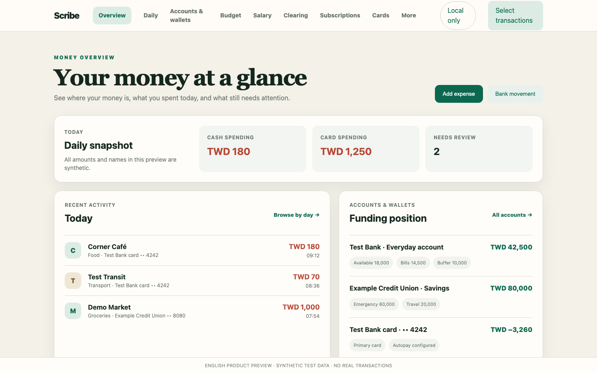

# Scribe

**[Project website](https://scribe-project.andylab.dev/en/)** ·
[繁體中文網站](https://scribe-project.andylab.dev/) ·
[Installation](docs/installation.md) ·
[Add a bank parser](docs/adding-bank-parser.md)

Scribe is a local-first Gmail transaction-notification tracker and personal
money dashboard. It synchronizes only the Gmail scope you configure, extracts
transaction evidence with deterministic Python parsers, and keeps email,
ledger, budget, subscription, salary-plan, and reconciliation data in a local
SQLite database. Normal use does not send mailbox or financial content to an
LLM, analytics service, or Scribe-operated server.



## Who this release is for

R1 is for technical self-hosters who are comfortable with Python, a terminal,
and creating their own Google OAuth Desktop client. macOS is the documented
service platform; the application itself supports Python 3.12 or newer. There
is no hosted service and no one-click installer. A future desktop installer can
reuse the same application services, but it is not part of this release.

## Quick start

Install [uv](https://docs.astral.sh/uv/) and clone this repository. From the
checkout:

```bash
uv sync --extra dev
uv run python -m app init
```

Create your own Gmail API Desktop OAuth client by following
[`docs/gmail-oauth.md`](docs/gmail-oauth.md), place its downloaded JSON at
`credentials.json`, then run:

```bash
uv run python -m app auth
uv run python -m app doctor
uv run python -m app sync --full --query "newer_than:1y"
uv run python -m app serve
```

Open <http://127.0.0.1:8000>. The dashboard remains usable from previously
synchronized SQLite data when Gmail is offline. Full synchronization is
paginated, resumable, thread-aware, and deduplicates by Gmail message ID;
subsequent runs use Gmail `historyId` incrementally and reconcile safely when a
cursor expires.

For a clean-machine walkthrough, prerequisites, and troubleshooting, use the
[`installation guide`](docs/installation.md).

## What Scribe includes

- Gmail OAuth with exact `gmail.readonly` scope by default and opt-in
  `gmail.modify` only for processed-message labels.
- Configurable sender rules, message-by-message thread expansion, bounded
  retry/backoff, resumable full sync, and incremental history sync.
- Local MIME, HTML-to-text, Big5/CP950, attachment, and encrypted text-PDF
  processing; decrypted PDF bytes and passwords are never stored in SQLite.
- Auditable multi-stage transaction classification, bank-specific parsers,
  generic fallback, parser provenance, confidence, reasons, and manual review.
- Immutable double-entry accounting with reversals, wallets, card liabilities,
  budget periods, subscriptions, salary allocation, scheduled clearing,
  day-by-day activity, source matching, balance snapshots, and reconciliation.
- Server-rendered FastAPI/Jinja2 pages with HTMX and Chart.js vendored locally;
  no Node build step and no browser CDN dependency.
- Verified SQLite backups, guarded restore with rollback copy, local diagnostics,
  and generated current-user macOS services.
- A strict local-only boundary for money administration. Optional LAN and
  Cloudflare Access modes are explicit, narrow, and disabled by default.

Parser support is evidence-based and format-specific, not a promise that every
message from an institution will parse. See
[`banks and parser coverage`](docs/banks-and-parsers.md).

## Documentation

- [Installation and first run](docs/installation.md)
- [Gmail OAuth setup and recovery](docs/gmail-oauth.md)
- [Configuration reference](docs/configuration.md)
- [Banks, notification shapes, and parser contributions](docs/banks-and-parsers.md)
- [Add a bank parser (including an LLM-safe workflow)](docs/adding-bank-parser.md)
- [Backup and restore](docs/backup-and-restore.md)
- [macOS background services](docs/macos-service.md)
- [Privacy and local security](PRIVACY.md)
- [Architecture](ARCHITECTURE.md)
- [Development and testing](DEVELOPMENT.md)
- [Security reporting](SECURITY.md)
- [Contributing](CONTRIBUTING.md)

## Security boundary

`credentials.json`, OAuth tokens, `config.toml`, databases, WAL/SHM files,
backups, logs, and generated LaunchAgents are ignored from Git. SQLite is not
encrypted: enable full-disk encryption, protect backups, and do not expose the
local dashboard through router port forwarding. Review [`PRIVACY.md`](PRIVACY.md)
before importing a real mailbox.

## License

Scribe is licensed under the
[GNU Affero General Public License v3.0 or later](LICENSE). Vendored browser
libraries retain their upstream licenses; see
[`THIRD_PARTY_NOTICES.md`](THIRD_PARTY_NOTICES.md).
